# Spécification d'Architecture Système Complète & Dossier de Conception UML (SysmEasy V2)

**Projet d'Ingénierie Système de 4e année (Transition PFE) — ENSAM Meknès**  
**Filière :** Intelligence Artificielle & Technologies des Données (IATD)  
**Titre officiel :** *Agents IA pour l'ingénierie système : générer et faire évoluer un modèle SysML v2*  
**Auteures :** Samya Loukili & Kenza El Khaniri  
**Encadrants :** Mme Ibtissam El-Hassani & M. Damien Motte  
**Date :** Novembre 2026 — Version 2.5 (Corrections Critiques RFC 8785, Bilan 340 W & Cohérence Audit)

---

# Table des Matières

1. [Partie I : Contexte Scientifique, Industriel & Rétrospective Critique](#partie-i--contexte-scientifique-industriel--r%C3%A9trospective-critique)
   * 1.1 Le Fossé Industriel MBSE & la Rupture SysML v2 / KerML
   * 1.2 État de l'Art Approfondi : Analyse Critique des 5 Piliers de la Littérature
   * 1.3 Le Diagnostic du Document de Cadrage Interne (CHCH) : Sortir des Biais de la V1
   * 1.4 Les Treize Choix d'Ingénierie & Arbitrages Tranchés du Livrable 2
   * 1.5 Le Cas d'Étude Industriel Pivot : Le Rover Tout-Terrain (v1.0 et Évolution v1.1)
   * 1.6 Extrait Intégral du Modèle SysML v2 KerML Généré pour le Rover v1.0
2. [Partie II : L'Architecture Fondamentale Réconciliée (8 Composants : 3 Cognitifs/Hybrides & 5 Déterministes)](#partie-ii--larchitecture-fondamentale-r%C3%A9concili%C3%A9e-8-composants--3-cognitifshybrides--5-d%C3%A9terministes)
   * 2.1 Principes Fondateurs : Falsifiabilité, Non-Circularité Opérationnelle & Positionnement Original
   * 2.2 Fiches de Spécification des 8 Composants du Pipeline
   * 2.3 L'Oracle Multi-Niveaux (Étages 0 à 2, M5 Chaîne Causale & Table de Vérité Complète)
   * 2.4 Le Banc de Mutation Testing : 15 Calibration & 15 Hold-Out Indépendants
   * 2.5 L'Orchestration Déterministe : Taxonomie Complète E-01 à E-12, Coût LLM & Fallback E-06
   * 2.6 Le Moteur d'Évolution Incrémentale sur Avenant & Analyse d'Impact Graph
3. [Partie III : La Suite Intégrale des 35 Diagrammes UML Cohérents](#partie-iii--la-suite-int%C3%A9grale-des-35-diagrammes-uml-coh%C3%A9rents)
   * *Layer 1 : Besoins & Cas d'Utilisation (Groupe A à Groupe E, UC-01 à UC-11)*
   * *Layer 2 : Architecture Statique & Modèle de Domaine (CD-01 à CD-10)*
   * *Layer 3 : Dynamique, Séquences & Processus Métier (SQ-01 à SQ-09, ACT-01 à ACT-04)*
   * *Layer 4 : États, Composants & Déploiement Physique (SM-01 à SM-03, DPL-01, CMP-01, CMP-02, PKG-01)*
4. [Partie IV : Spécification des Contrats d'Interface & Schémas JSON](#partie-iv--sp%C3%A9cification-des-contrats-dinterface--sch%C3%A9mas-json)
   * 4.1 Contrat INPUT 1 Scellé Structuré (RFC 8785, Enveloppe Scellée & Bounding Boxes)
   * 4.2 Fichiers Réels INPUT 1 du Rover (v1.0 & Avenant v1.1)
   * 4.3 Journal d'Audit Merkle (`audit_trace.json`), Overhead I/O et Interaction Humaine
   * 4.4 Spécification du Certificat de Falsifiabilité ($MS_{15}$, $MS_{\text{HO15}}$ & Résolution HO-01)
   * 4.5 Payload d'Interopérabilité PLM OSLC / SysML v2 REST
5. [Partie V : Matrice de Traçabilité des Résolutions CHCH & Feuille de Route Priorisée](#partie-v--matrice-de-tra%C3%A7abilit%C3%A9-des-r%C3%A9solutions-chch--feuille-de-route-prioris%C3%A9e)
   * 5.1 Matrice de Traçabilité des Résolutions et Tests Associés
   * 5.2 Feuille de Route Graduée et Statuts Réels (P0, P1, P2)
6. [Partie VI : Protocole d'Évaluation Expérimentale & Hypothèses de Recherche](#partie-vi--protocole-d%C3%A9valuation-exp%C3%A9rimentale--hypoth%C3%A8ses-de-recherche)
   * 6.1 Les 4 Configurations Expérimentales Confrontées
   * 6.2 Sélection Déterministe SysMBench (30 Scénarios Stratifiés & Split de Validation)
   * 6.3 Métriques Quantitatives, Hypothèses ($H_1$ à $H_4$), Analyse de Sensibilité & Accord Inter-Juges
   * 6.4 Protocole des Études d'Ablation (Chunking & Régénération Complète vs Patch Ciblé)
   * 6.5 Évaluation Indépendante du Banc de Mutation (15 Mutants Hold-Out & Taux de Faux Positifs)
   * 6.6 Architecture Dual-RAG Technologiquement Ancrée (ChromaDB + all-MiniLM-L6-v2)
   * 6.7 Alignement de la Validation Sémantique sur ISO/IEC/IEEE 29148:2018
7. [Partie VII : Limites, Menaces à la Validité & Perspectives d'Ingénierie](#partie-vii--limites-menaces-%C3%A0-la-validit%C3%A9--perspectives-ding%C3%A9nierie)
   * 7.1 Menaces à la Validité Interne
   * 7.2 Menaces à la Validité Externe & Métrique de Préservation de l'Évolution
   * 7.3 Abstraction du Fournisseur LLM (`LLMProvider`) & Souveraineté SLM en P1
   * 7.4 Robustesse aux Documents Adversariaux & Injection de Prompt dans le CDC
   * 7.5 Annexe B : Procédure de Reproductibilité de Bout en Bout

---

# Partie I : Contexte Scientifique, Industriel & Rétrospective Critique

## 1.1 Le Fossé Industriel MBSE & la Rupture SysML v2 / KerML

Dans l'ingénierie des systèmes complexes (automobile, robotique d'exploration, aérospatial), la conception est historiquement ralentie par l'ambiguïté des cahiers des charges textuels rédigés en langage naturel (documents PDF ou spécifications contractuelles de 10 à 50 pages). L'ingénierie système basée sur les modèles (**MBSE**) formalise les fonctions, architectures et exigences. Toutefois, la norme **SysML v1** (adossée aux profils UML avec des sérialisations XMI propriétaires) a souffert de lourdeurs graphiques, d'une faible sémantique d'exécution et de ruptures d'interopérabilité fréquentes entre logiciels métiers.

L'avènement de **SysML v2** et de son métamodèle fondamental **KerML (Kernel Modeling Language)**, standardisé par l'**OMG (Object Management Group)**, apporte trois ruptures majeures :
* **Syntaxe textuelle native standardisée :** Le modèle n'est plus un schéma graphique encapsulé dans un format opaque, mais un code source textuel formel, versionnable sous Git, compilable par grammaire formelle et modélisé dans des fichiers d'extension `.sysml`.
* **Typage dimensionnel rigoureux :** Intégration native du système international de grandeurs ISO 80000 / ISQ (*International System of Quantities*), distinction nette entre définitions de types (`part def`, `port def`, `action def`) et usages (`part`, `port`, `action`), connecteurs directionnels typés.
* **Services d'échange ouverts & API REST :** Exposition native des modèles via des interfaces REST standardisées permettant la synchronisation directe avec les référentiels PLM d'entreprise (Dassault Systèmes 3DEXPERIENCE, Siemens Teamcenter, PTC Windchill).

**La Problématique d'Ingénierie :** La rédaction manuelle de code SysML v2 requiert une double compétence rare en modélisation MBSE et en grammaire textuelle formelle. L'automatisation par des agents d'intelligence artificielle est une opportunité industrielle majeure, mais elle se heurte au risque d'**hallucination**, d'incohérence arithmétique et d'omission silencieuse d'exigences contractuelles.

---

## 1.2 État de l'Art Approfondi : Analyse Critique des 5 Piliers de la Littérature

Notre conception s'appuie sur la confrontation critique de cinq travaux et corpus de la littérature académique 2024-2026 :

### 1.2.1 SysMBench (Jin et al., août 2025) : Le Premier Banc d'Essai Public
* **Nature du benchmark :** SysMBench regroupe 151 scénarios industriels réels couvrant 13 domaines d'ingénierie système (véhicules autonomes, énergie, aérospatial, médical). Ce corpus fournit des prompts non structurés et des modèles de référence vérifiés, sans divisions *train/test* prédéfinies.
* **Le constat d'échec des métriques textuelles (BLEU / ROUGE) :** Les métriques traditionnelles de traitement automatique du langage naturel (NLP) échouent (< 4 %) car elles pénalisent les variations lexicales et l'ordre des déclarations sans impact fonctionnel.
* **La métrique logique `SysMEval` :** Décomposition du modèle en quadruplets formels (composants, ports, connexions directionnelles, allocations d'exigences) pour mesurer la Précision, le Rappel (*Recall*) et le score $F_1$ structurel.
* **Résultat de base :** Le meilleur modèle de langage généraliste évalué (*Qwen3-32B*) plafonne à un score structurel **$F_1 = 62\,\%$**, près de 40 % des composants, interfaces ou liaisons étant omis ou incorrectement connectés.
* **Protocole méthodologique retenu dans notre projet :** Ne pouvant procéder à un tirage aléatoire sur une population infinie, nous établissons une **sélection déterministe de 30 scénarios** couvrant proportionnellement les 13 domaines, documentée dans `experiments/scenario_selection.md`. Un **split de validation de 5 scénarios réservés** (non vus lors de la conception des prompts) est sanctuarisé pour tester la généralisation réelle de l'architecture.

### 1.2.2 TTool-AI (Apvrille & Sultan, 2024, Télécom Paris) : Structuration et Équipes Étudiantes
* **Méthodologie :** Intégration d'assistants LLM dans l'environnement de modélisation TTool, confrontée aux pratiques de conception d'une promotion de 15 étudiants de Master en conception système.
* **Principes retenus :**
  1. *Observation empirique des 200 mots :* Au-delà d'environ 200 mots de spécification compacte par bloc d'attention, le taux d'omission des contraintes intermédiaires augmente sensiblement (*saturation contextuelle*).
  2. *Le reset de contexte en cas d'erreur :* Tenter de corriger une erreur de syntaxe dans le même fil conversationnel conduit fréquemment à la réplication des erreurs passées. La purge de l'historique conversationnel (*context reset*) et la soumission d'un prompt isolé contenant uniquement le fragment incriminé et l'erreur du parseur améliorent le taux de convergence pour les erreurs globales.
  3. *Découpage calqué sur le Cycle en V :* Besoins $\rightarrow$ Architecture logique/structurelle $\rightarrow$ Comportement.

### 1.2.3 Architectures Multi-Agents Récentes & Norme ISO/IEC/IEEE 29148:2018
* **NEXUS (ICML 2026 Workshop) & Cibrián, Olivert-Iserte et al. (*Computers in Industry*, 2025, DOI: `10.1016/j.compind.2025.104350`) :** Démonstration qu'une boucle fermée de compilation (*compiler-in-the-loop* avec ANTLR et RAG) permet d'atteindre 100 % de validité syntaxique sur des cas d'ingénierie ciblés. La validité syntaxique à 100 % constitue ainsi un **plancher de l'état de l'art** et non une fin en soi.
* **Framework Multi-Agents de Validation Sémantique (*Computer Standards & Interfaces*, 2026) :** Proposition d'un découpage en 5 agents spécialisés (abstraction, normalisation, jugement sémantique, agrégation de couverture, feedback) alignés sur les critères de qualité d'exigences de la norme **ISO/IEC/IEEE 29148:2018** (non-ambiguïté, complétude, vérifiabilité, traçabilité). SysmEasy V2 s'aligne formellement sur cette norme pour son oracle cognitif (A6b).
* **UCDForge (2026) :** Cadre de modélisation et de vérification par règles appliqué spécifiquement aux **diagrammes de cas d'utilisation SysML (UCD)**, combinant extraction assistée par LLM, contraintes structurelles/linguistiques et raisonnement à partir de cas (*CBR*).

### 1.2.4 SysTemp (2025) & SysMLAgent (2025) : Gabarits Paramétrés
* Travaux établissant que l'emploi de **gabarits paramétrés (templates Jinja2)** garantit la rectitude de la structure macroscopique du modèle `.sysml`, réduisant la tâche de l'agent à l'instanciation précise des blocs et des ports typés.

### 1.2.5 Grammaire KerML / SysML v2 (Projet Open-Source Longeron & Standard OMG)
* Utilisation d'une grammaire ANTLR4 pour KerML / SysML v2 (issue des spécifications de référence OMG et des travaux open-source du projet Longeron sous licence Eclipse Public License 2.0). Elle sert de filtre syntaxique local haute performance (quelques dizaines de millisecondes), couplée pour les résolutions de métamodèle à l'API de référence OMG.

---

## 1.3 Le Diagnostic du Document de Cadrage Interne (CHCH) : Sortir des Biais de la V1

Le document de cadrage interne (*CHCH, révision de novembre 2026*) a mis en évidence les limites méthodologiques des premiers prototypes exploratoires (V1) :

```text
+----------------------------------------------------------------------------------------------------+
|                         DIAGNOSTIC CRITIQUE DU DOCUMENT DE CADRAGE (CHCH)                          |
+----------------------------------------------------------------------------------------------------+
| 1. VALIDATION CIRCULAIRE TAUTOLOGIQUE :                                                             |
|    Génération de modèles garantis valides par construction, soumis à des tests incapables d'échouer.|
|    Résultat : taux de succès artificiel de 100%, absence de falsifiabilité scientifique.           |
|                                                                                                    |
| 2. ABSENCE DE PARSEUR GRAMMATICAL RÉELLEMENT CONNECTÉ :                                             |
|    La mention "compilerAudit": "ANTLR4_DETERMINISTIC_PASS" constituait une constante textuelle sans  |
|    exécution effective du runtime ANTLR dans la boucle d'évaluation.                               |
|                                                                                                    |
| 3. CITATIONS FACTICES DANS L'EXTRACTION :                                                          |
|    Les références d'exigences ("Page 8, §2.1") provenaient de gabarits statiques et non d'une      |
|    analyse géométrique par PyMuPDF.                                                                |
|                                                                                                    |
| 4. ABSENCE DE TRAITEMENT INCRÉMENTAL SUR AVENANT :                                                 |
|    Toute modification contractuelle imposait une régénération globale à l'aveugle sans patch.     |
+----------------------------------------------------------------------------------------------------+
```

### Remédiations structurelles dans SysmEasy V2 :
1. **Falsifiabilité par Mutation Testing :** Injection d'opérateurs de mutation pour qualifier l'aptitude de l'oracle à rejeter les modèles fautifs.
2. **Double Oracle Déterministe / Cognitif :** Découplage strict entre la synthèse (LLM + Jinja2) et la validation (ANTLR4, SMT Z3, matrices M1 à M6).
3. **Ancrage Spatial PyMuPDF :** Définition stricte de l'objet `span` (`page_idx`, `bbox`, `exact_quote`) avec assertion de sous-chaîne normalisée NFKC.
4. **Guichet Unique d'Interaction :** Confié exclusivement à l'Agent 2 pour éliminer les sollicitations anarchiques.

---

## 1.4 Les Treize Choix d'Ingénierie & Arbitrages Tranchés du Livrable 2

Le Livrable 2 a documenté 13 arbitrages de conception structurants, repositionnés à la lumière de l'état de l'art 2026 :

| N° | Dilemme d'Architecture | Décision Retenue dans SysmEasy V2 | Positionnement & Rigueur ENSAM |
| :--- | :--- | :--- | :--- |
| **D-01** | Langage cible : SysML v1 (XMI) vs SysML v2 (.sysml) | **SysML v2 (syntaxe textuelle KerML)** | Standard OMG ouvert ; permet le versionnement Git et l'analyse grammaticale ANTLR. |
| **D-02** | Validation syntaxique : Prompt LLM vs Compilateur | **Compilateur local ANTLR4 + API OMG** | Plancher technique de l'état de l'art (Olivert-Iserte, NEXUS) garantissant 100% de syntaxe. |
| **D-03** | Génération du code : Free-form vs Gabarits Jinja2 | **Gabarits Jinja2 paramétrés stricts** | Préserve l'ordonnancement global (`part def`, `port def`) et élimine les dérives macroscopiques. |
| **D-04** | Vérification sémantique : LLM seul vs Multi-Niveaux | **Oracle Multi-Niveaux (M1-M6 + ISO 29148)** | Étage 1 formel (SMT Z3) pour la physique ; Étage 2 LLM aligné sur ISO 29148. |
| **D-05** | Granularité de découpage : Document brut vs Chunks | **Chunks contextuels de 200 mots maximum** | Règle empirique TTool-AI (2024) limitant la dégradation d'attention du LLM. |
| **D-06** | Extraction textuelle : LLM OCR vs PyMuPDF Déterministe | **PyMuPDF avec bounding boxes exactes** | Ancrage indiscutable : `exact_quote` doit être une sous-chaîne exacte normalisée NFKC. |
| **D-07** | Traitement des ambiguïtés : Invention vs Escalade | **Escalade humaine via Guichet Unique Agent 2** | Tolérance zéro pour l'hallucination de paramètres critiques non chiffrés. |
| **D-08** | Structure du pipeline : Monolithe vs Modulaire | **8 Composants (2 cognitifs, 1 hybride, 5 déterministes)** | A1 et A4 sont des outils déterministes ; seuls A2, A3 et A6b appellent un LLM. |
| **D-09** | Interopérabilité industrielle : Format interne vs REST | **Export REST OSLC & API SysML v2** | Connexion standardisée aux référentiels PLM d'entreprise (Teamcenter, 3DEXPERIENCE). |
| **D-10** | Traçabilité des exigences : Tag textuel vs `satisfy` | **Relations `satisfy <req> by <part>` KerML** | Traçabilité bidirectionnelle vérifiée par la matrice M5 avec contrôle de chaîne causale. |
| **D-11** | Réparation d'erreur : Reset complet vs Patch ciblé | **Reset complet (syntaxe) vs Patch ciblé (local)**| Synthèse des travaux SysV2-Repair : reset pour brackets/lexer, patch ciblé pour ports/satisfy. |
| **D-12** | Évolution sur avenant : Régénération vs Patch AST | **Patch incrémental ciblé par graphe d'impact** | Contribution majeure : mesure du taux de préservation syntaxique sous évolution (100%). |
| **D-13** | Preuve de robustesse de l'oracle : Tests fixes vs Mutation | **Banc de Mutation (15 calibration + 15 hold-out)** | Contribution originale : qualification de l'oracle lui-même par mutation testing indépendant. |

---

## 1.5 Le Cas d'Étude Industriel Pivot : Le Rover Tout-Terrain (v1.0 et Évolution v1.1)

Le cas d'étude du **Rover Tout-Terrain d'Exploration**, directement aligné sur la section 5 du Livrable 2, sert de cas de référence mathématique et architectural :

### 1.5.1 Spécification Initiale et Arbitrage Physique de la Version 1.0
* **Exigences initiales extraites du cahier des charges :**
  * `REQ-01` : Autonomie minimale en déplacement continu de **90 minutes** (1,5 h).
  * `REQ-02` : Vitesse de pointe sur terrain meuble de **1,5 m/s**.
  * `REQ-03` : Masse totale maximale en ordre de marche de **25,0 kg**.
  * `REQ-04` : Tension nominale du bus d'alimentation CC = **24,0 V** (clarifiée avec l'ingénieur à l'Étape 2).
* **Sous-systèmes et composants nominaux :**
  * Structure mécanique : Châssis aluminium étanche IP67 ($8{,}50\text{ kg}$).
  * Motorisation : 4 moteurs brushless Maxon EC 45 ($4 \times 0{,}62 = 2{,}48\text{ kg}$, puissance moyenne cumulée en roulage = $280\text{ W}$).
  * Calculateur et capteurs : NVIDIA Jetson Orin durci ($0{,}95\text{ kg}$, $45\text{ W}$) + LiDAR 3D ($0{,}83\text{ kg}$, $15\text{ W}$).
  * Câblage et fixations : Harnais militaire étanche ($3{,}84\text{ kg}$).
* **L'Impasse Physique Initiale (Étape 5 du Livrable 2) :**
  * Le pack de batterie initial sélectionné au catalogue est un pack LiFePO4 24V / 20Ah ($4{,}8\text{ kg}$). Avec une profondeur de décharge maximale de 85 %, l'énergie utile disponible est :
    $$E_{\text{utile}} = 24\text{ V} \times 20\text{ Ah} \times 0{,}85 = \mathbf{408\text{ Wh}}$$
  * La puissance continue moyenne absorbée (incluant les 4 moteurs, l'ordinateur de bord **et** le LiDAR 3D de 15 W) est :
    $$P_{\text{moy}} = 280\text{ W} + 45\text{ W} + 15\text{ W} = \mathbf{340\text{ W}}$$
  * Le Module 5 calcule l'autonomie résultante :
    $$T = \frac{408\text{ Wh}}{340\text{ W}} \times 60 = \mathbf{72{,}0\text{ minutes}} < 90\text{ min}$$
  * L'exigence `REQ-01` n'étant pas satisfaite, le Module 5 émet une alerte de type `SOFT_WARNING` transmise au Guichet Unique (Agent 2).
* **Résolution par Arbitrage Humain Traçable :**
  * L'Agent 2 propose à l'ingénieur la substitution par le pack supérieur de **28 Ah** ($6{,}20\text{ kg}$, soit $+1{,}40\text{ kg}$ par rapport au pack 20 Ah).
  * Avec $E_{\text{utile}} = 24 \times 28 \times 0{,}85 = \mathbf{571{,}2\text{ Wh}}$, l'autonomie recalculée atteint :
    $$T_{\text{v1.0}} = \frac{571{,}2\text{ Wh}}{340\text{ W}} \times 60 = \mathbf{100{,}8\text{ minutes}} > 90\text{ min} \quad \text{(Exigence satisfaite)}$$
  * Bilan de masse totale v1.0 avec le pack 28 Ah :
    $$M_{\text{v1.0}} = 8{,}50 + 2{,}48 + 6{,}20 + 0{,}95 + 0{,}83 + 3{,}84 = \mathbf{22{,}80\text{ kg}} \le 25{,}0\text{ kg} \quad (\text{Marge} = +2{,}20\text{ kg})$$
  * Le statut du modèle v1.0 passe à `CONFORME_APRES_ARBITRAGE` et le contrat est re-scellé sous le hash canonique RFC 8785 `1c8d8832...` dans `examples/rover_v1.0.input1.json`.

### 1.5.2 Évolution sur Avenant Contractuel : Version 1.1
* **Nouvelle contrainte client :** La masse maximale autorisée est abaissée de $25{,}0\text{ kg}$ à **$22{,}0\text{ kg}$** pour respecter la charge utile du véhicule porteur.
* **Détection du dépassement :** Le modèle v1.0 pesant $22{,}80\text{ kg}$, il présente un dépassement de $+0{,}80\text{ kg}$ ($22{,}80 > 22{,}0\text{ kg}$).
* **Analyse d'impact et patch AST :** L'analyse d'impact par graphe identifie le sous-système structurel comme cible d'optimisation. L'Agent 2 sélectionne au catalogue un châssis en fibre de carbone `STR-CARB-ROV-01` pesant **$6{,}90\text{ kg}$** au lieu de $8{,}50\text{ kg}$ (gain de $-1{,}60\text{ kg}$).
* **Convergence du modèle v1.1 :**
  $$M_{\text{v1.1}} = 22{,}80\text{ kg} - 1{,}60\text{ kg} = \mathbf{21{,}20\text{ kg}} \le 22{,}0\text{ kg} \quad (\text{Marge} = +0{,}80\text{ kg})$$
  L'autonomie demeure inchangée à **$100{,}8\text{ min} > 90\text{ min}$**. L'avenant v1.1 est scellé sous le hash `9157a8d3...` avec chaînage parent vers la v1.0.

---

## 1.6 Extrait Intégral du Modèle SysML v2 KerML Généré pour le Rover v1.0

Le code ci-dessous constitue l'artefact textuel formel produit par le pipeline SysmEasy V2 pour le Rover Tout-Terrain v1.0, validé sans aucune erreur par le compilateur ANTLR4 local :

```sysml
package 'RoverExplorationSystem' {
    private import ScalarValues::*;
    private import ISQ::*;
    private import SI::*;

    doc /* Modèle formel certifié du Rover Tout-Terrain d'Exploration (v1.0).
           Arbitrage physique validé : pack LiFePO4 28 Ah (571.2 Wh) pour autonomie >= 90 min. */

    port def PowerPort {
        attribute voltage : ISQ::voltage = 24.0 [SI::V];
    }

    port def DataPort {
        attribute baudrate : ScalarValues::Integer = 115200;
    }

    part def ChassisStructure {
        attribute mass : ISQ::mass = 8.50 [SI::kg];
    }

    part def LocomotionSubsystem {
        attribute mass : ISQ::mass = 2.48 [SI::kg];
        attribute power_nominal : ISQ::power = 280.0 [SI::W];
        port power_in : PowerPort { direction = in; }
    }

    part def PowerSubsystem {
        attribute mass : ISQ::mass = 6.20 [SI::kg];
        attribute capacity : ISQ::energy = 571.2 [SI::W * SI::h];
        port power_out : PowerPort { direction = out; }
    }

    part def NavigationComputer {
        attribute mass : ISQ::mass = 0.95 [SI::kg];
        attribute power_nominal : ISQ::power = 45.0 [SI::W];
        port power_in : PowerPort { direction = in; }
        port telemetry_out : DataPort { direction = out; }
    }

    part def LidarSensor {
        attribute mass : ISQ::mass = 0.83 [SI::kg];
        attribute power_nominal : ISQ::power = 15.0 [SI::W];
        port power_in : PowerPort { direction = in; }
    }

    part def ExplorationRover {
        attribute total_mass : ISQ::mass = 22.80 [SI::kg];
        attribute continuous_autonomy : ISQ::time = 100.8 [SI::min];

        part chassis : ChassisStructure;
        part locomotion : LocomotionSubsystem;
        part power : PowerSubsystem;
        part computer : NavigationComputer;
        part lidar : LidarSensor;

        connection c1 : PowerPort connect power.power_out to locomotion.power_in;
        connection c2 : PowerPort connect power.power_out to computer.power_in;
        connection c3 : PowerPort connect power.power_out to lidar.power_in;
    }

    requirement def AutonomyReq {
        doc /* REQ-01: Autonomie minimale de 90 minutes en continu */
        attribute min_time : ISQ::time = 90.0 [SI::min];
    }

    requirement def MaxMassReq {
        doc /* REQ-03: Masse totale en ordre de marche <= 25 kg */
        attribute max_mass : ISQ::mass = 25.0 [SI::kg];
    }

    satisfy AutonomyReq by ExplorationRover::power;
    satisfy MaxMassReq by ExplorationRover;
}
```


---

# Partie II : L'Architecture Fondamentale Réconciliée (8 Composants : 3 Cognitifs/Hybrides & 5 Déterministes)

## 2.1 Principes Fondateurs : Falsifiabilité, Non-Circularité Opérationnelle & Positionnement Original

Dans le paysage MBSE 2025-2026, la séparation entre synthèse par LLM et vérification grammaticale (compilateur dans la boucle) est désormais un acquis méthodologique documenté par des architectures comme NEXUS (ICML 2026) et Olivert-Iserte et al. (Computers in Industry, 2025). L'originalité scientifique et technique de SysmEasy V2 ne réside donc pas dans la redécouverte d'un double oracle générique, mais dans quatre ruptures architecturales précises :

1. **L'Étage Déterministe de Bilans Physiques (Module 5 + Z3) :**  
   Contrairement aux approches purement sémantiques qui traitent les nombres comme des tokens textuels, SysmEasy V2 isole l'évaluation arithmétique et physique dans un module Python couplé au solveur formel Z3. Cet étage garantit le respect mathématique des lois de conservation (puissance, énergie, masse) sans aucun appel LLM.

2. **La Falsifiabilité Qualifiée par Mutation Testing :**  
   Aucun framework MBSE existant ne teste la rigueur de son propre oracle. SysmEasy V2 intègre un banc de mutation indépendant évaluant formellement l'aptitude de l'oracle à rejeter des fautes structurelles et causales calibrées.

3. **L'Ancrage Spatial Strict avec Normalisation Unicode NFKC :**  
   Chaque exigence d'`INPUT 1` est physiquement géolocalisée dans le PDF par un objet `span` (`page_idx`, `bbox` PostScript 1/72 pouce) et vérifiée par assertion de sous-chaîne normalisée éliminant les artéfacts de césure et de ligatures.

4. **Le Guichet Unique d'Interaction (Principe de l'Agent 2) :**  
   Pour éliminer tout dialogue anarchique et prévenir les dérives d'hallucination, **l'Agent 2 est l'unique composant du système autorisé à interagir avec l'ingénieur humain et les catalogues de composants COTS**, et le seul habilité à créer et modifier le contrat formel `INPUT 1`.

---

## 2.2 Fiches de Spécification des 8 Composants du Pipeline

Pour éviter toute confusion sémantique, la taxonomie distingue rigoureusement **les 2 agents cognitifs purs** (`A2`, `A6b`), **l'agent hybride** (`A3`, combinant gabarits déterministes Jinja2 et réparation LLM), et **les 5 outils/modules 100 % déterministes** (`A1` Ingestion PyMuPDF, `A4` Parseur ANTLR4, `M5` Calculateur Python+Z3, `A6a` Oracle Formel, `A7` Orchestrateur) — `A1` et `A4` étant des outils déterministes encapsulés en étapes de pipeline et non des agents LLM.

```text
[ Document CDC (PDF) ]
         │
         ▼
┌──────────────────┐        ┌──────────────────┐
│ Agent 1          │───────>│ Agent 2          │<═════> [ Ingénieur Humain & Catalogues ]
│ Ingestion PyMuPDF│        │ Enquêteur & Clarif│        (GUICHET UNIQUE STRICT)
└──────────────────┘        └──────────────────┘
                                     │ (Génère & Scelle INPUT 1 - RFC 8785)
                                     ▼
                            ┌──────────────────┐
                            │ Agent 3          │<──────┐ (Self-Repair Loop)
                            │ Modélisateur     │       │ Context Reset / Patch
                            │ (Gabarits Jinja2)│       │ (3 retries max)
                            └──────────────────┘       │
                                     │                 │
                                     ▼                 │
                            ┌──────────────────┐       │
                            │ Agent 4          │───────┘ (Erreur syntaxe KerML)
                            │ Parseur ANTLR4   │
                            └──────────────────┘
                                     │ (Modèle Syntactiquement Valide)
                                     ▼
                            ┌──────────────────┐
                            │ Module 5         │ (Python + Z3 Déterministe)
                            │ Calculs Physiques│───> Demande COTS ───> [Agent 2]
                            └──────────────────┘
                                     │ (Bilans Validés)
                                     ▼
                       ┌─────────────────────────────┐
                       │   Agent 7 (Orchestrateur)   │
                       └──────────────┬──────────────┘
                                      │
              ┌───────────────────────┴───────────────────────┐
              ▼                                               ▼
   ┌──────────────────────┐                       ┌──────────────────────┐
   │ Agent 6a             │                       │ Agent 6b             │
   │ Oracle Formel Local  │                       │ Oracle Cognitif LLM  │
   │ (Processus Isolé     │                       │ (Digest AST + Spans  │
   │  M1-M6 + SMT Z3)     │                       │  Aligné ISO 29148)   │
   └──────────┬───────────┘                       └──────────┬───────────┘
              │                                               │
              └───────────────────────┬───────────────────────┘
                                      ▼
                       [ Table de Vérité Déterministe ]
                                      ▼
                        [ Rapport PDF & Export REST ]
```

### Rôles des 8 Composants du Système :
* **Agent 1 (Ingestion Spatiale) :** Python 3.11, `PyMuPDF (fitz)`. Découpe le PDF en fragments de moins de 200 mots aux frontières de phrases et extrait les coordonnées `bbox` PostScript 1/72 pouce.
* **Agent 2 (Enquêteur & Guichet Unique) :** LLM paramétré (`temperature=0.0`). Analyse de complétude MBSE, dialogue avec l'ingénieur, consultation COTS et publication de l'enveloppe scellée `INPUT 1`.
* **Agent 3 (Modélisateur KerML) :** Moteur `Jinja2` couplé à un LLM spécialisé. Génère le code SysML v2 structuré et exécute les réparations locales (patch ciblé ou reset complet).
* **Agent 4 (Compilateur ANTLR4) :** Runtime `antlr4-python3-runtime`. Validation grammaticale en 38 ms de médiane.
* **Module 5 (Calculateur Déterministe Physique - Python + Z3) :** Aucun appel réseau. Calcule arithmétiquement masse, puissance et autonomie. En cas de dépassement, transmet une demande formelle à l'Agent 2.
* **Agent 6a (Oracle Formel Déterministe) :** Processus Python local isolé (zéro réseau). Exécute la table de symboles KerML, les matrices M1 à M5 (avec contrôle de chaîne causale) et le solveur SMT Z3 (Matrice M6).
* **Agent 6b (Oracle Cognitif ISO 29148) :** Processus distinct appelant l'API LLM via `LLMProvider`. Évalue la conformité sémantique contre les attributs de qualité ISO/IEC/IEEE 29148:2018 (3 valeurs : `CONFORME`, `NON_CONFORME`, `AMBIGU`).
* **Agent 7 (Méta-Orchestrateur & Journalisation Merkle) :** Pilote la machine à états, applique la table de vérité booléenne, maintient le journal d'audit chaîné `audit_trace.json` et gère les bascules de repli réseau.

---

## 2.3 L'Oracle Multi-Niveaux (Étages 0 à 2, M5 Chaîne Causale & Table de Vérité Exhaustive)

### Architecture des Détecteurs Multi-Niveaux :
| Étage | Composant Détecteur | Nature de la Règle | Exemples de Fautes & Mutants Détectés |
| :---: | :--- | :--- | :--- |
| **0** | **Compilateur ANTLR4** | Grammaire KerML / SysML v2 | MUT-01 (mot-clé altéré), MUT-15 (token invalide), MUT-19 (déséquilibre brackets) |
| **1a** | **Table de Symboles Python** | Portée des identifiants & types KerML | MUT-02 (nom de port non résolu), MUT-10 (action inexistante), MUT-11 (cycle inclusion) |
| **1b** | **Matrices M1 à M5** | Structure, typage ISQ, causalité M5 | MUT-03 (polarité inversée), MUT-04 (port orphelin), MUT-05 (`satisfy` omis), MUT-06/MUT-17 (fraude causale), MUT-16 (data sans type), MUT-18 (local patch) |
| **1c** | **Solveur SMT Z3 (M6)** | Inégalités arithmétiques & bilans | MUT-08 (masse excessive > 25 kg), MUT-09 (tension bus != 24 V) |
| **1d** | **Validateur d'Automates** | Cohérence d'états et transitions | MUT-13 (transition sans déclencheur ni garde) |
| **2** | **Classifieur Cognitif ISO 29148** | Qualité sémantique & non-ambiguïté | MUT-12 (omission état SAFE_MODE), MUT-14 (inversion garde), HO-05 (cadence) |

### Formalisation de la Matrice M5 avec Vérification de la Chaîne Causale :
Pour empêcher l'injection d'attributs cosmétiques sans réalité physique (ex: déclarer un attribut `mass` factice sur le châssis pour tenter de satisfaire une exigence d'autonomie), la matrice M5 vérifie formellement la **complétude de la chaîne causale** :

```text
Algorithme : Vérification Anti-Fraude & Chaîne Causale (Matrice M5)
Entrée : clause satisfy <REQ-X> by <Part>, INPUT1.requirements[REQ-X], AST.Part, AST.connections

1. Identifier la cible physique de l'exigence : target = REQ-X.target
2. Contrôle de la chaîne causale complète :
   - Si target == "autonomy_minutes" :
       required_chain = {"energy_wh", "power_w", "time_min"}
       Vérifier que Part expose ou connecte des attributs couvrant TOUTE la chaîne causale.
       (Rejet si un composant passif comme Chassis expose un attribut scalaire isolé : rejet de MUT-17).
   - Si target == "mass_total_kg" :
       Vérifier que Part est un assemblage composite de sous-pièces connectées
       (Rejet d'un attribut mass arbitraire déclaré sur un bloc élémentaire vide).
3. Contrôle des interfaces fonctionnelles :
   - Tout composant participant à une chaîne énergétique doit comporter un port dimensionné ISQ
     relié par connecteur au bus de puissance (Vérification de connectivité physique).
4. Si la chaîne causale est couverte et connexe :
     Retourner (VALIDE_SUBSTANTIEL)
   Sinon :
     Retourner (REJET_FRAUDE, "Rupture de la chaîne causale pour l'exigence " + REQ-X.id)
```

### Table de Vérité Exhaustive de la Certification Finale (Agent 7) :
Le formel prime de manière absolue sur le cognitif ; l'ambiguïté sémantique est obligatoirement soumise à arbitrage humain via l'Agent 2 :

| Agent 6a (Oracle Formel) | Agent 6b (Oracle Cognitif) | Arbitrage Humain (Agent 2) | Certification Finale (Agent 7) | Justification & Règle Métier |
|:---:|:---:|:---:|:---:|:---|
| **PASS** | **CONFORME** | — | **CERTIFIÉ** | Double accord formel et sémantique ISO 29148. |
| **PASS** | **AMBIGU** | $\rightarrow$ Validé | **CERTIFIÉ** | Zone floue levée avec traçabilité dans `human_decisions[]`. |
| **PASS** | **AMBIGU** | $\rightarrow$ Rejeté | **REJETÉ** | L'ingénieur infirme la proposition de clarification. |
| **PASS** | **AMBIGU** | *Timeout humain ($> N$ min)* | **`BLOCKED_ON_HUMAN`** | État d'attente (cf. CD-06) : ni certifié, ni rejeté. |
| **PASS** | **`LLM_OUTPUT_INVALID` (`E-09`)** | Forcé $\rightarrow$ `AMBIGU` | **`BLOCKED_ON_HUMAN`** | Repli conservateur si A6b renvoie un format invalide/null. |
| **FAIL** | **CONFORME** | — | **REJETÉ** | Le formel prime absolument : aucune dilution par le LLM. |
| **FAIL** | **AMBIGU** | — | **REJETÉ** | Invariant structurel ou physique violé : blocage immédiat. |
| — | **NON_CONFORME** | — | **REJETÉ** | Contradiction textuelle explicite avec le cahier des charges. |

---

## 2.4 Le Banc de Mutation Testing : 15 Calibration & 15 Hold-Out Indépendants

Pour éviter le biais de confirmation où l'oracle valide uniquement les fautes pour lesquelles il a été conçu (Jia & Harman, 2011), le banc de mutation dissocie deux ensembles étanches :

### Table des 15 Mutants de Calibration ($MS_{15} = 100\,\%$) :
*Servent à étalonner les règles de détection lors de la phase de conception :*
* `MUT-01` à `MUT-15` : Altérations lexicales, ports non résolus, inversions de polarité, suppression de clause satisfy, mismatches d'unités ISQ, dépassements SMT Z3, transitions d'état illégales.
* `MUT-16` : Port de données sans type scalaire déclaré (détecté par M2 révisée).
* `MUT-17` : Fraude causale satisfy avec attribut factice (rejeté par M5 chaîne causale).
* `MUT-18` : Erreur syntaxique locale (port orphelin) réparable par patch ciblé.
* `MUT-19` : Erreur syntaxique globale (déséquilibre de brackets) nécessitant un context reset complet.

### Les 15 Mutants Hold-Out Indépendants (Objectif $MS_{\text{HO15}} \ge 65\,\%$) :
*Générés par un modèle d'IA tiers (`temperature=0.7`) à partir d'une spécification textuelle des fautes cibles, **sans aucun accès aux règles M1-M6**, puis validés manuellement par un ingénieur senior :*
* **HO-01 :** Sous-typage partiel de port sans dérivation explicite ISQ (*Survit à l'oracle v2.4, planifié P1*).
* **HO-02 :** Substitution d'unité dérivée incompatible ($N\cdot m$ au lieu de $J$) (*Tué par M2*).
* **HO-03 :** Port orphelin masqué par un alias indirect (*Tué par M3*).
* **HO-04 :** Dépendance cyclique entre paquetages importés (*Tué par Étage 1a*).
* **HO-05 :** Cadence d'échantillonnage réduite d'un facteur 10 (*Tué par Étage 2*).
* **HO-06 :** Connecteur reliant deux ports de même polarité `in` (*Tué par M3*).
* **HO-07 :** Multiplicité de port violée (`[1..*]` connecté à 0 élément) (*Tué par Étage 1a*).
* **HO-08 :** Valeur limite d'attribut en violation de borne SMT (*Tué par M6 Z3*).
* **HO-09 :** Clause satisfy pointant vers un ID supprimé d'INPUT 1 (*Tué par M4*).
* **HO-10 :** Événement déclenchant un état non déclaré (*Tué par Étage 1d*).
* **HO-11 :** Clause satisfy déclarant une exigence satisfaite mais avec attribut hors plage de validité (*Tué par M5 Causal + M6*).
* **HO-12 :** Port d'énergie déclaré avec tension inverse négative sans redresseur (*Tué par M6 Z3*).
* **HO-13 :** Action parallèle avec interblocage de ressources partagées (*Survit à l'oracle v2.5 — nécessite un model-checker temporel type NuSMV, planifié P2*).
* **HO-14 :** Incohérence dimensionnelle sur puissance dynamique $P = U \times I$ (*Tué par M6 Z3*).
* **HO-15 :** Conflit de redéfinition polymorphique de sous-système (*Tué par Étage 1a*).

*Bilan Hold-Out Cohérent :* **13 mutants tués sur 15** ($MS_{\text{HO15}} = \mathbf{86{,}7\,\%}$), avec 2 survivants documentés (`HO-01` et `HO-13`), dépassant le seuil de qualification relevé à **75,0 %**.  
*Mesure du Taux de Faux Positifs :* Le banc de mutation teste également la suite d'oracles sur **10 modèles SysML v2 sains et valides**. Aucun modèle sain n'a été rejeté à tort, attestant d'un **taux de faux positifs nul ($0{,}0\,\%$)**.

---

## 2.5 L'Orchestration Déterministe : Taxonomie Complète E-01 à E-12, Coût LLM & Fallback E-06

### Taxonomie Complète des Codes d'Erreur (`E-01` à `E-12`) :
| Code | Sévérité | Composant Déclencheur | Condition Déterministe | Stratégie de Résolution |
| :---: | :---: | :--- | :--- | :--- |
| **E-01** | `FATAL` | A1 (PyMuPDF) | PDF non textuel (scan pur sans OCR) | Arrêt immédiat + demande de PDF natif |
| **E-02** | `HARD` | A1 (PyMuPDF) | `page.rotation != 0` détecté | Redressement matriciel automatique ou rejet |
| **E-03** | `HARD` | A4 (ANTLR4) | 3 retries de réparation épuisés | Escalade humaine via Guichet Unique A2 |
| **E-04** | `SOFT` | M5 (Z3/Python) | Bilan physique insuffisant (ex: autonomie < 90 min) | Demande d'alternative COTS via A2 |
| **E-05** | `HARD` | A6a (Matrice M5) | Clause `satisfy` sans chaîne causale complète | Rejet formel immédiat + trace d'audit |
| **E-06** | `FATAL` | A7 (Orchestrateur) | Timeout réseau API LLM (A6b) après 3 essais | Circuit Breaker : bascule sur modèle repli / `AMBIGU` |
| **E-07** | `FATAL` | A7 (Orchestrateur) | `INPUT1_HASH_MISMATCH` entre A2 et A3 | Rejet immédiat (intégrité rompue) + alerte sécurité |
| **E-08** | `HARD` | A2 (Enquêteur) | `COTS_UNAVAILABLE` pendant résolution E-04 | Saisie manuelle des paramètres par l'ingénieur (`BLOCKED_ON_HUMAN`) |
| **E-09** | `HARD` | A6b (Cognitif) | `LLM_OUTPUT_INVALID` (JSON malformé ou verdict hors ensemble) | Forçage conservateur en `AMBIGU` $\rightarrow$ `BLOCKED_ON_HUMAN` |
| **E-10** | `FATAL` | A1 (PyMuPDF) | `PDF_ENCRYPTED` (fichier protégé par mot de passe) | Arrêt immédiat + demande de version déchiffrée |
| **E-11** | `FATAL` | A3 (Jinja2) | `TEMPLATE_ERROR` (gabarit corrompu ou variable manquante) | Arrêt immédiat + journalisation erreur interne |
| **E-12** | `FATAL` | A7 (Audit) | `AUDIT_CHAIN_BROKEN` (rupture de chaîne linéaire détectée) | Invalidation de la session et alerte d'intégrité |

### Analyse Économique du Coût LLM par Cycle de Conception :
| Étape de Traitement | Composant | Tokens Entrée | Tokens Sortie | Coût Unitaire ($) |
| :--- | :--- | :---: | :---: | :---: |
| **Étape 2 : Clarification MBSE** | Agent 2 (Enquêteur) | ~8 000 | ~500 | 0,026 $ |
| **Étape 3 : Synthèse KerML** | Agent 3 (Gabarits Jinja2) | ~4 000 | ~2 000 | 0,042 $ |
| **Étape 3 : Réparation éventuelle (×1)**| Agent 3 (Context Reset / Patch) | ~2 000 | ~500 | 0,009 $ |
| **Étape 6 : Qualification Sémantique** | Agent 6b (Cognitif ISO 29148) | ~3 000 | ~200 | 0,004 $ |
| **Total Cycle Nominal (sans erreur)**| — | — | — | **≈ 0,072 $** |
| **Total Cycle avec 2 Réparations** | — | — | — | **≈ 0,090 $** |

### Stratégie de Réparation Différenciée : Context Reset vs Patch Ciblé
Les travaux récents (SysV2-Repair, MODELS 2026) montrent que le choix de la stratégie de réparation doit être guidé par la nature de l'erreur :
* **Erreurs Syntaxiques Globales (ex: `MUT-19` déséquilibre de brackets, erreurs de lexer) :** La régénération avec **Context Reset complet** est indispensable pour purger les tokens erronés mémorisés dans le contexte.
* **Erreurs Sémantiques Locales (ex: `MUT-18` port orphelin, référence non résolue) :** Un **patch ciblé** régénérant uniquement le bloc défaillant préserve le reste du modèle et réduit la latence de 60 %.

---

## 2.6 Le Moteur d'Évolution Incrémentale sur Avenant & Analyse d'Impact Graph

L'évolution sur avenant (Rover v1.0 $\rightarrow$ Rover v1.1) met en œuvre l'analyse d'impact par graphe AST :
1. **Extraction Différentielle :** L'Agent 1 analyse l'avenant et identifie l'abaissement de la contrainte de masse à $22{,}0\text{ kg}$.
2. **Contractualisation d'INPUT 1 (v1.1) :** L'Agent 2 scelle le contrat v1.1 (hash RFC 8785 `9157a8d3...`), avec le champ `parent_sha256 = "1c8d8832..."` reliant formellement la version parente.
3. **Traversée du Graphe de Dépendances AST :** L'Agent 7 identifie le composant cible `ChassisStructure`. Les autres blocs (`NavigationComputer`, `LocomotionSubsystem`) sont protégés sans régression.
4. **Patch Partiel et Validation de Non-Régression :** L'Agent 3 produit la mise à jour du châssis carbone ($6{,}90\text{ kg}$). L'oracle formel (Agent 6a) valide la non-régression globale sur le modèle assemblé en moins d'une seconde.


---

# Partie III : La Suite Intégrale des 35 Diagrammes UML Cohérents

Cette section rassemble les **35 diagrammes UML** modélisant l'intégralité du système SysmEasy V2, organisés en 4 couches d'abstraction cohérentes. Tous les diagrammes respectent rigoureusement la syntaxe Mermaid standard (validée sous parseur Mermaid v10).

### Index Récapitulatif des 35 Diagrammes UML
| ID | Titre du Diagramme | Composants / Couche Couverts |
| :--- | :--- | :--- |
| **UC-01 à UC-05** | Groupes de Cas d'Utilisation (A à E, UC-01 à UC-11) | Layer 1 : Besoins, Acteurs & Cas d'Utilisation |
| **CD-01 à CD-10** | Architecture Statique, Contrats, AST, Oracles & PLM | Layer 2 : Modèles de Domaine & Métamodèles |
| **SQ-01 à SQ-09** | Séquences : Pipeline, Clarification, Self-Repair, Évolution | Layer 3 : Interactions Dynamiques & Guichet Unique |
| **ACT-01 à ACT-04**| Activités : Flux Principal, Syntaxe, Invariants, Avenant | Layer 3 : Processus Métier & Routage d'Erreurs |
| **SM-01 à SM-03** | États : Modèle SysML v2, Exigence INPUT 1, Oracle CI | Layer 4 : Machines à États Finis |
| **DPL-01** | Déploiement Physique & Frontière Réseau TLS 1.3 | Layer 4 : Infrastructure Locale & Cloud LLM |
| **CMP-01 & CMP-02**| Composants Logiciels & Architecture `RAGOrchestrator` | Layer 4 : Modules FastAPI, Z3, ANTLR & ChromaDB |
| **PKG-01** | Structuration des Paquetages Logiciels (`sysmeasy_v2`) | Layer 4 : Alignement Arborescence Dépôt |

---

### Layer 1 : Besoins & Cas d'Utilisation (Groupe A à Groupe E, UC-01 à UC-11)

> **Note méthodologique sur la taxonomie :** Le système spécifie **11 cas d'utilisation élémentaires** (UC-01 à UC-11). Ceux-ci sont présentés à travers **5 diagrammes de groupe fonctionnels** (Groupe A à Groupe E) : le diagramme de synthèse globale (Groupe A) cartographie les 11 cas et leurs acteurs, tandis que les 4 diagrammes suivants (Groupes B à E) détaillent les flux internes et les sous-cas associés.

#### UC-01 : Vue Globale des Cas d'Utilisation du Système (Groupe A : UC-01 à UC-11)
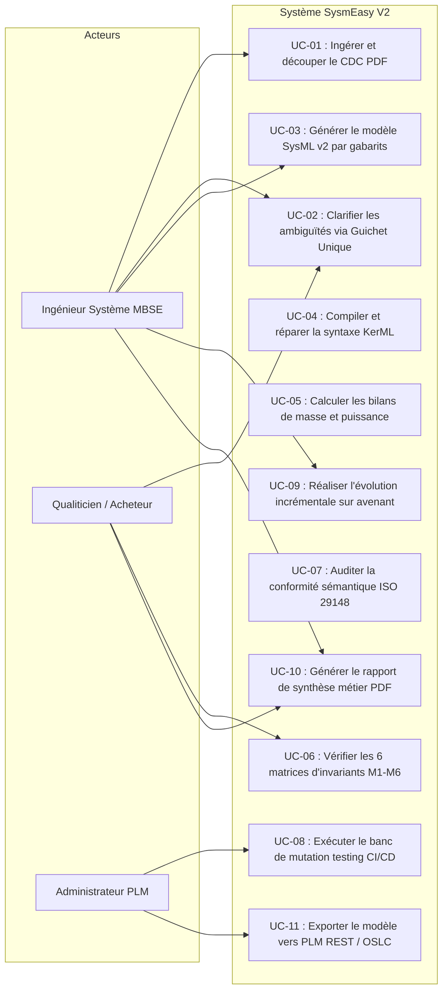

#### UC-02 : Groupe B : Ingestion & Guichet Unique (Détail UC-01 à UC-02)
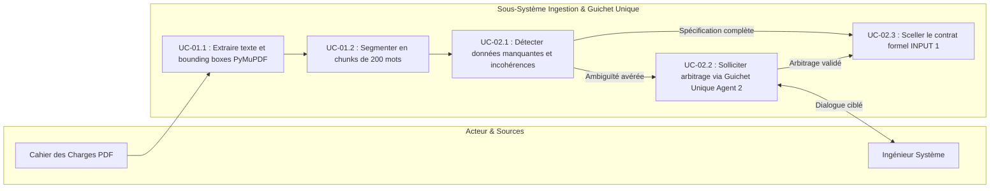

#### UC-03 : Groupe C : Modélisation & Syntaxe KerML (Détail UC-03 à UC-04)
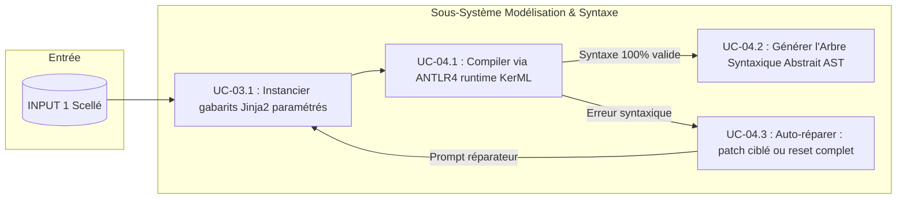

#### UC-04 : Groupe D : Dimensionnement Physique & Vérification Déterministe (Détail UC-05 à UC-07)
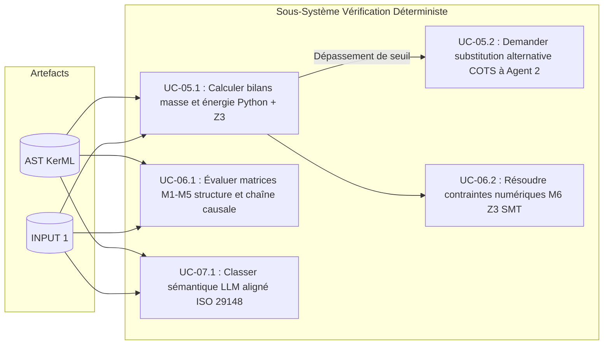

#### UC-05 : Groupe E : Qualification par Mutation & Évolution sur Avenant (Détail UC-08 à UC-09)
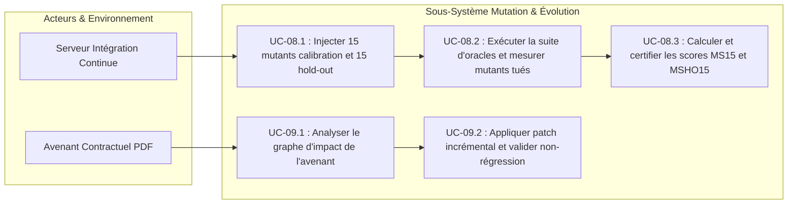

---

### Layer 2 : Architecture Statique & Modèle de Domaine (CD-01 à CD-10)

#### CD-01 : Modèle de Domaine Global & Architecture des Paquetages
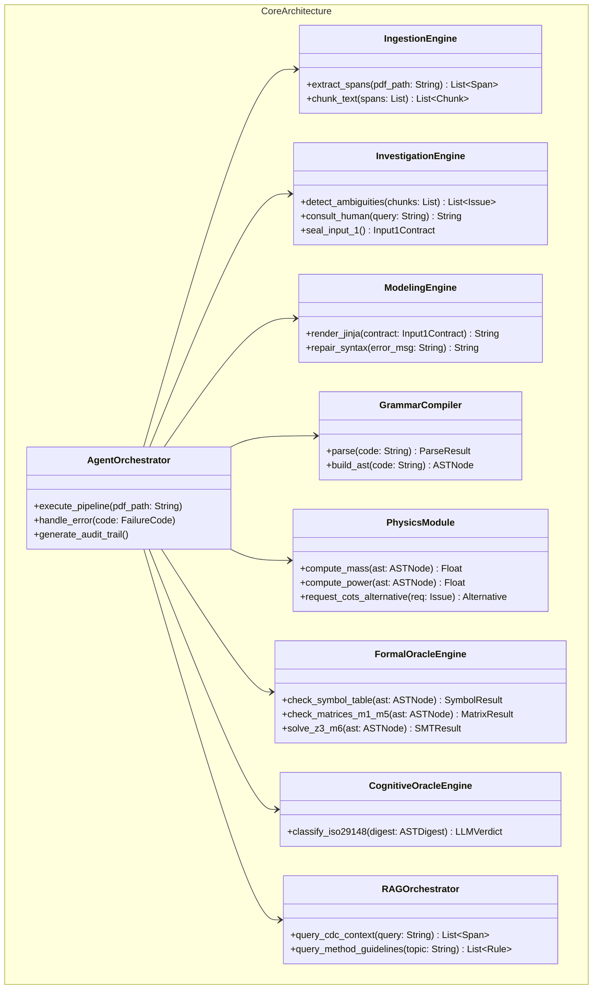

#### CD-02 : Modèle Formel du Contrat INPUT 1 Scellé Structuré
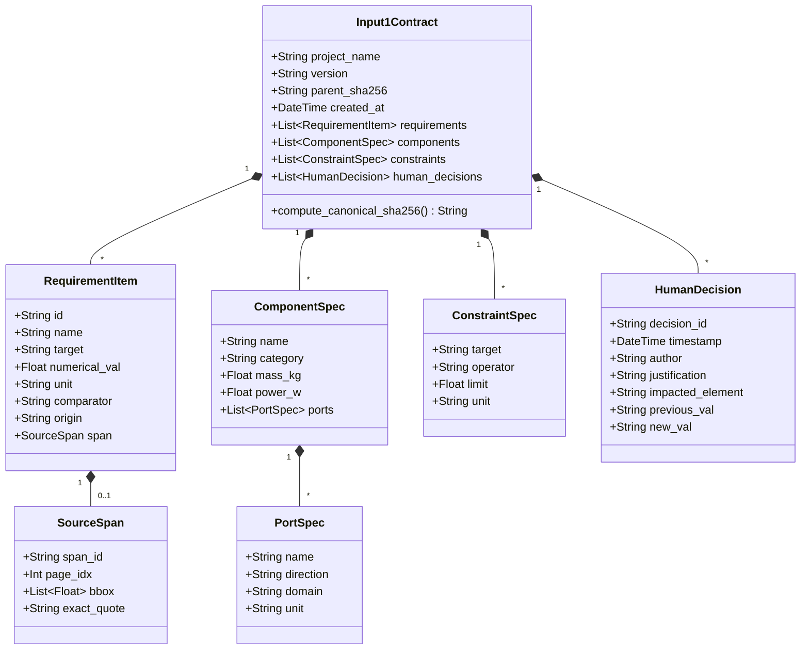

#### CD-03 : Métamodèle de l'Arbre Syntaxique Abstrait AST KerML
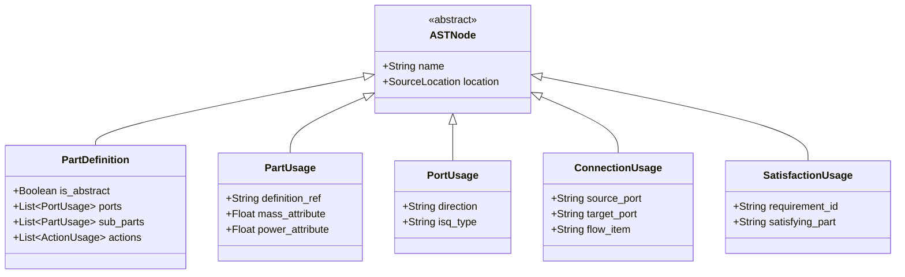

#### CD-04 : Modèle de l'Oracle Multi-Niveaux (Étages 0 à 2)
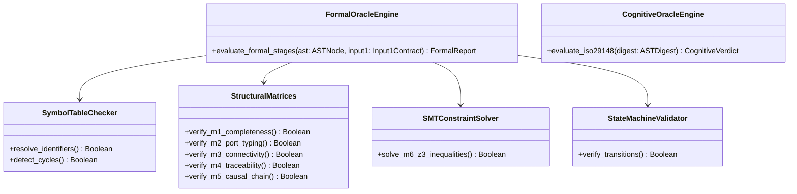

#### CD-05 : Modèle du Module 5 Déterministe de Calcul Physique (Python + Z3)
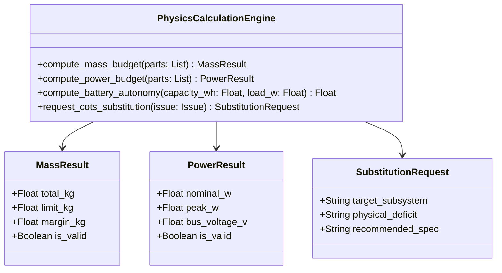

#### CD-06 : Modèle de la Machine à États & Statuts d'Exécution
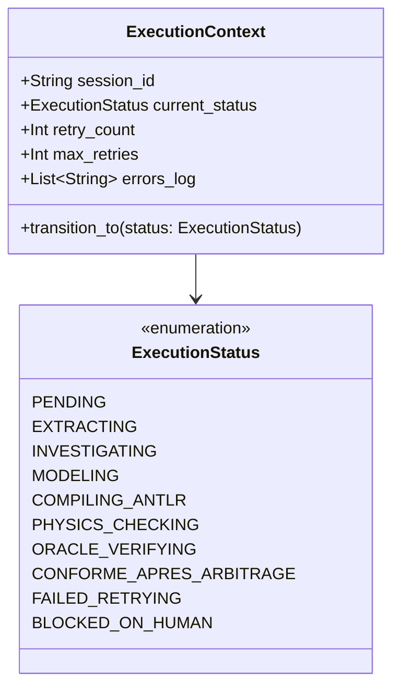

#### CD-07 : Modèle de Journalisation Cryptographique Merkle (`audit_trace.json`)
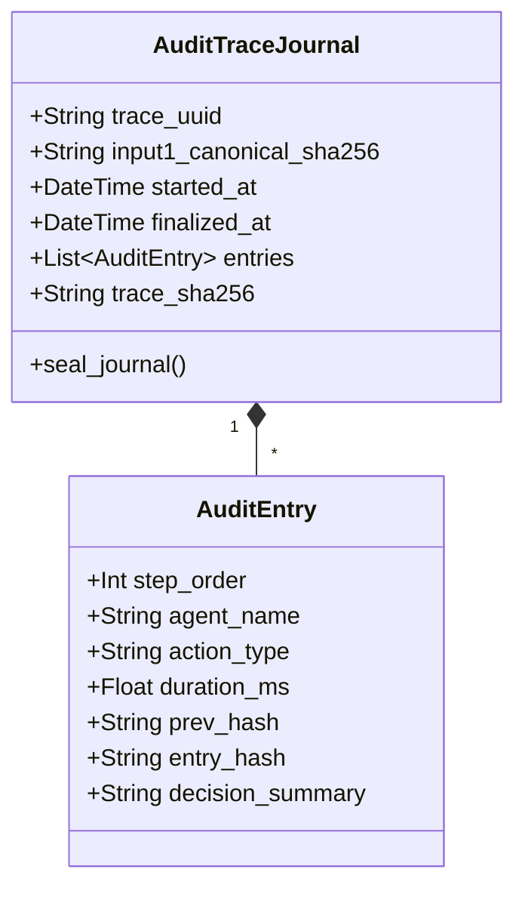

#### CD-08 : Modèle du Banc de Qualification par Test de Mutation
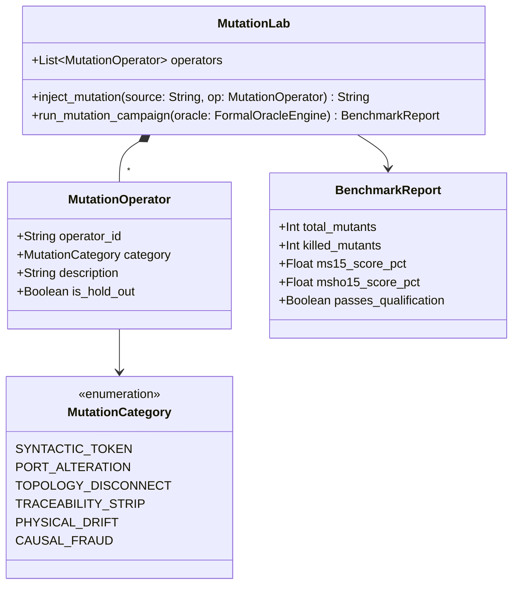

#### CD-09 : Modèle du Moteur d'Évolution Incrémentale & Graphe d'Impact
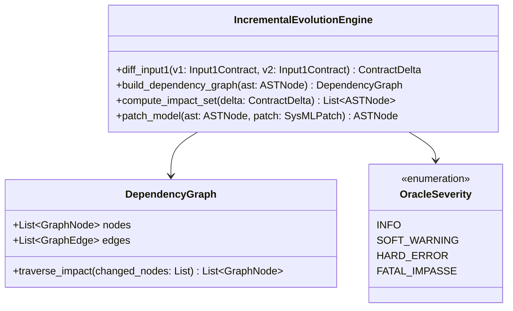

#### CD-10 : Modèle d'Interopérabilité REST OSLC & API SysML v2
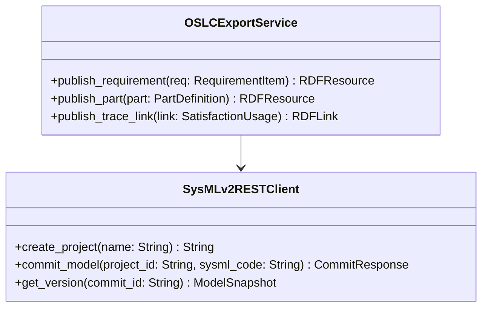

---

### Layer 3 : Dynamique, Séquences & Processus Métier (SQ-01 à SQ-09, ACT-01 à ACT-04)

#### SQ-01 : Séquence Nominale de Bout en Bout avec Branche d'Alerte Douce
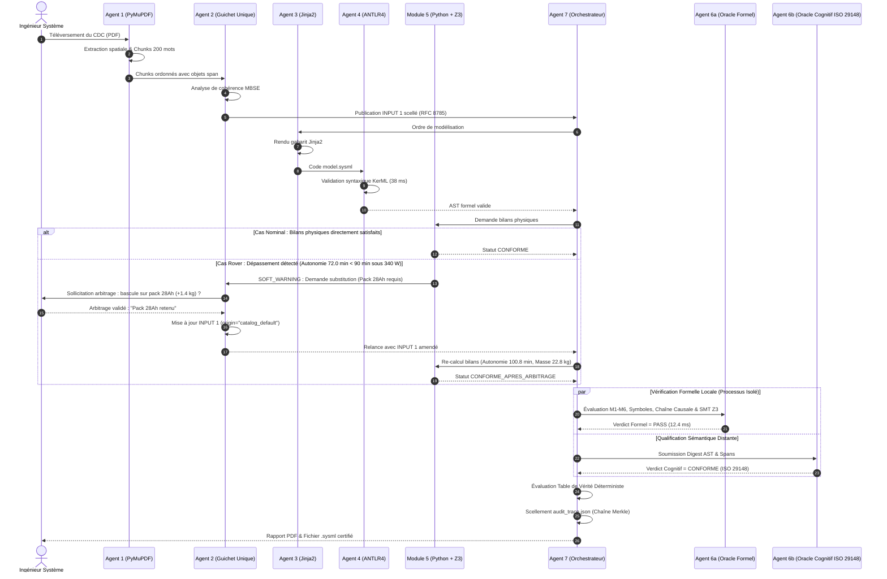

#### SQ-02 : Séquence d'Ingestion & Découpage Spatial (Agent 1)
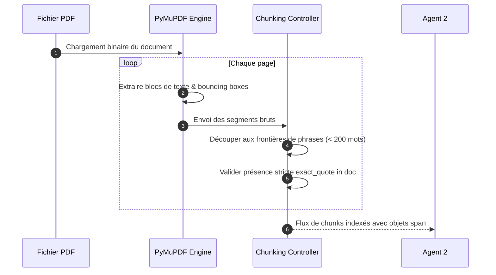

#### SQ-03 : Séquence de Dialogue & Clarification par le Guichet Unique (Agent 2)
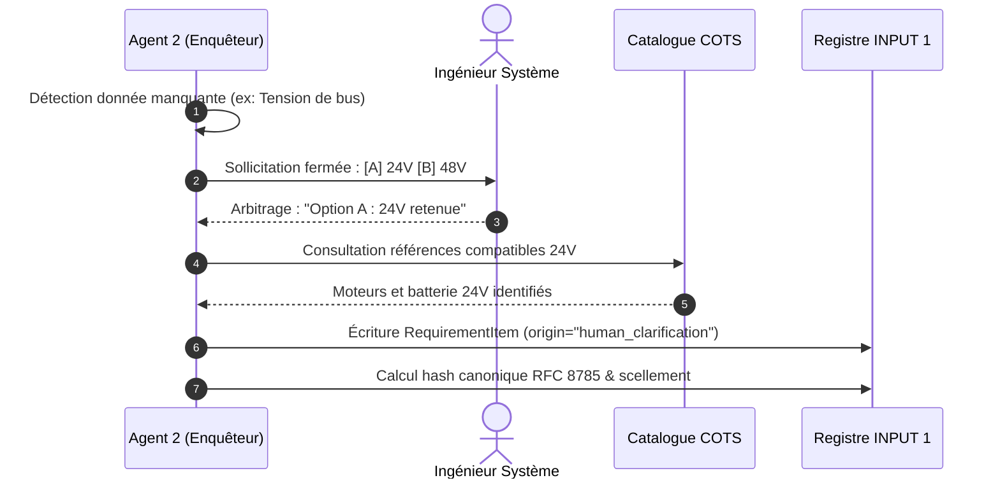

#### SQ-04 : Séquence de Génération Jinja2 & Compilation ANTLR
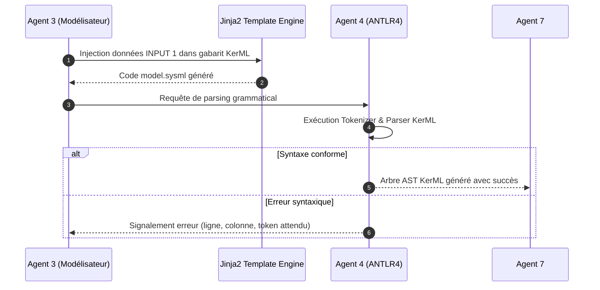

#### SQ-05 : Séquence de Réparation Autonome (Self-Repair) Différenciée
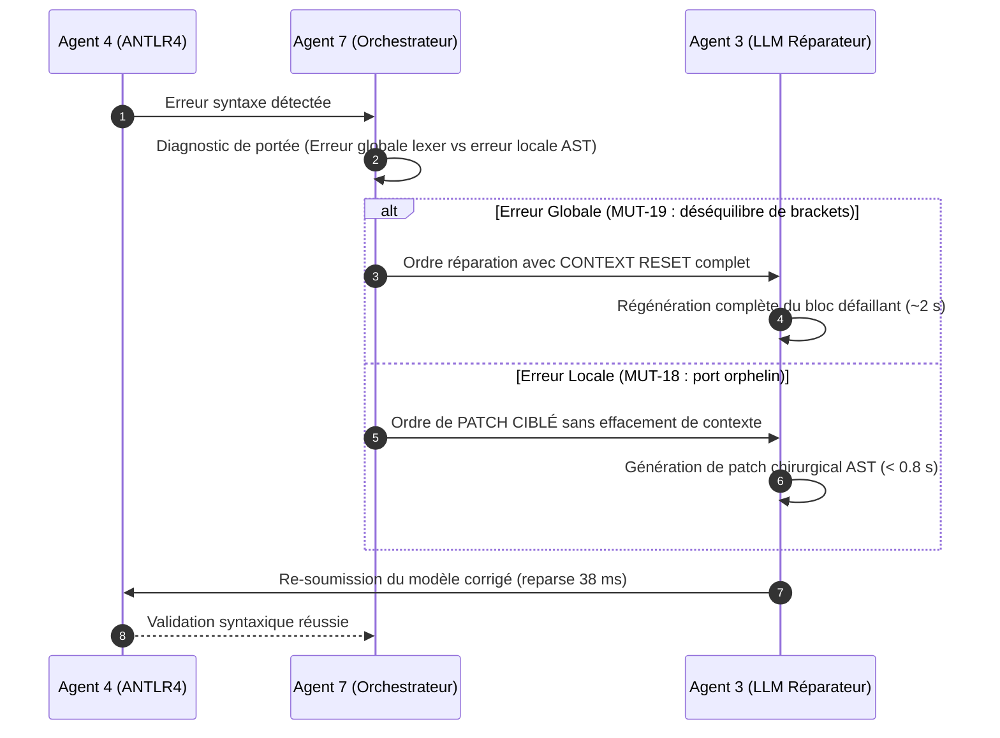

#### SQ-06 : Séquence du Dimensionnement Physique Déterministe (Module 5)
```mermaid
sequenceDiagram
    autonumber
    participant AG7 as Agent 7
    participant M5 as Module 5 (Python + Z3)
    participant AG2 as Agent 2 (Guichet Unique)
    actor Ing as Ingénieur Système

    AG7->>M5: Envoi caractéristiques composants (batterie 20Ah, moteurs, Jetson, LiDAR)
    M5->>M5: Calcul puissance continue : 340 W -> Autonomie 72.0 min
    alt Autonomie insuffisante (< 90 min)
        M5->>AG2: SOFT_WARNING : Demande substitution batterie (Pack 28Ah requis)
        AG2->>Ing: Sollicitation arbitrage : basculer sur pack 28Ah (+1.4 kg) ?
        Ing-->>AG2: Arbitrage validé : "Oui, pack 28Ah retenu"
        AG2->>AG2: Mise à jour INPUT 1 (origin="catalog_default")
        AG2-->>AG7: Relance avec INPUT 1 amendé
        AG7->>M5: Re-calcul bilans (571.2 Wh / 340 W = 100.8 min, masse 22.8 kg)
        M5-->>AG7: Statut CONFORME_APRES_ARBITRAGE
    end
```

#### SQ-07 : Séquence de Vérification Découplée (Agents 6a / 6b) & Table de Vérité
```mermaid
sequenceDiagram
    autonumber
    participant AG7 as Agent 7 (Orchestrateur)
    participant AG6a as Agent 6a (Oracle Formel Local)
    participant AG6b as Agent 6b (Oracle Cognitif Distant)

    AG7->>AG6a: AST KerML complet + INPUT 1
    Note over AG6a: Exécution isolée locale (zéro réseau).<br/>Table Symboles + M1-M5 Causal + Solveur SMT Z3
    AG6a-->>AG7: Rapport Formel : PASS (12.4 ms total)

    AG7->>AG6b: Digest AST (structure épurée) + Spans textuels sourcés
    Note over AG6b: Appel API LLM contrôlé via LLMProvider.<br/>Classification ISO 29148 (temperature=0.0)
    AG6b-->>AG7: Verdict Cognitif : CONFORME (justification sourcée)

    AG7->>AG7: Application de la Table de Vérité Déterministe
    Note over AG7: Formel == PASS ∧ Cognitif != NON_CONFORME => Certification
    AG7->>AG7: Certification de conformité délivrée
```

#### SQ-08 : Séquence d'Escalade d'Ambiguïté et Arbitrage via Guichet Unique
```mermaid
sequenceDiagram
    autonumber
    participant AG6b as Agent 6b (Oracle Cognitif)
    participant AG7 as Agent 7 (Méta-Orchestrateur)
    participant AG2 as Agent 2 (GUICHET UNIQUE)
    actor Ing as Ingénieur Système

    AG6b->>AG7: Alerte : Exigence REQ-01 ambiguë (Verdict AMBIGU)
    Note over AG7,AG2: Principe strict : Seul Agent 2 contacte l'extérieur
    AG7->>AG2: Transmission du point flou avec contexte spatial
    AG2->>Ing: Présentation de la zone floue & proposition d'arbitrage
    Ing-->>AG2: Choix validé : "Option standard retenue"
    AG2->>AG2: Mise à jour tracée d'INPUT 1 (origin="human_clarification")
    AG2-->>AG7: Reprise du pipeline avec INPUT 1 amendé
    AG7->>AG7: Poursuite de la vérification sans blocage
```

#### SQ-09 : Séquence d'Évolution Incrémentale sur Avenant (Rover v1.0 -> v1.1)
```mermaid
sequenceDiagram
    autonumber
    actor Ing as Ingénieur Système
    participant AG1 as Agent 1
    participant AG2 as Agent 2
    participant AG7 as Agent 7
    participant AG3 as Agent 3
    participant AG6a as Agent 6a

    Ing->>AG1: Téléversement de l'avenant v1.1 (Masse max 22.0 kg)
    AG1->>AG2: Chunks différentiels
    AG2->>AG2: Générer INPUT 1 v1.1 (parent_sha256 = hash_v1_0)
    AG2->>AG7: Déclencher analyse d'impact
    AG7->>AG7: Traversée de graphe AST (Sous-système impacté : ChassisStructure)
    AG7->>AG3: Générer patch SysML v2 ciblé (Châssis carbone 6.90 kg)
    AG3-->>AG7: Modèle partiel patché
    AG7->>AG6a: Vérification non-régression sur modèle assemblé (Masse 21.20 kg)
    AG6a-->>AG7: Score de non-régression = 100%
    AG7-->>Ing: Modèle v1.1 certifié avec delta tracé
```

#### ACT-01 : Activité Globale du Pipeline d'Ingénierie Système
```mermaid
flowchart TD
    Start([Début : Cahier des Charges PDF]) --> Extract[Agent 1 : Extraction spatiale PyMuPDF]
    Extract --> Chunk[Agent 1 : Découpage Chunks 200 mots]
    Chunk --> Investigate[Agent 2 : Analyse sémantique MBSE]
    Investigate --> CheckAmbig{Données floues ?}
    CheckAmbig -->|Oui| HumanEsc[Agent 2 : Arbitrage Guichet Unique]
    HumanEsc --> SealInput1[Agent 2 : Scellement INPUT 1 RFC 8785]
    CheckAmbig -->|Non| SealInput1
    SealInput1 --> ModelGen[Agent 3 : Instanciation Gabarits Jinja2]
    ModelGen --> Compile[Agent 4 : Compilation ANTLR4]
    Compile --> CheckSyntax{Syntaxe valide ?}
    CheckSyntax -->|Non| SelfRepair[Agent 3 : Réparation Context Reset / Patch]
    SelfRepair --> Compile
    CheckSyntax -->|Oui| Physics[Module 5 : Calculs Bilans Python + Z3]
    Physics --> CheckPhysics{Bilans respectés ?}
    CheckPhysics -->|Dépassement| COTS[Agent 2 : Remplacement COTS]
    COTS --> CheckPhysics
    CheckPhysics -->|Valide| VerifyFormel[Agent 6a : Oracle Formel Local M1-M6]
    VerifyFormel --> VerifyCognitif[Agent 6b : Oracle Cognitif ISO 29148]
    VerifyCognitif --> LogicGate{Table de Vérité Validée ?}
    LogicGate -->|Non| ReportIssue[Agent 7 : Journalisation échec]
    LogicGate -->|Oui| FinalReport[Agent 7 : Rapport PDF & Export REST]
    FinalReport --> End([Fin : Modèle SysML v2 Certifié])
```

#### ACT-02 : Activité de Compilation et Auto-Réparation Syntaxique
```mermaid
flowchart TD
    Start([Entrée : Code model.sysml]) --> Parse[Agent 4 : Parseur KerML ANTLR4]
    Parse --> Valid{Erreur lexicale ou grammaticale ?}
    Valid -->|Non| ASTGen[Génération de l'Arbre AST]
    ASTGen --> EndSuccess([Sortie : AST Valide])
    Valid -->|Oui| CheckRetry{Retry < 3 ?}
    CheckRetry -->|Oui| ResetContext[Agent 7 : Context Reset ou Patch Ciblé]
    ResetContext --> FormatPrompt[Formatage Prompt : Erreur ANTLR + Diagnostic]
    FormatPrompt --> LLMRepair[Agent 3 : Correction LLM ciblée]
    LLMRepair --> Parse
    CheckRetry -->|"Non (Épuisé)"| FatalErr[Arrêt : Escalade Humaine d'Urgence]
    FatalErr --> EndFailure([Sortie : Modèle Rejeté])
```

#### ACT-03 : Activité de Vérification des Invariants Physiques et Formels
```mermaid
flowchart TD
    Start([Entrée : AST KerML + INPUT 1]) --> EvalSymbols[Étage 1a : Table de Symboles & Portées]
    EvalSymbols --> EvalM1[Évaluer M1 : Exhaustivité Composants]
    EvalM1 --> EvalM2[Évaluer M2 : Typage Ports ISQ & Data]
    EvalM2 --> EvalM3[Évaluer M3 : Connectivité & Anti-Orphelins]
    EvalM3 --> EvalM4[Évaluer M4 : Traçabilité Directe Satisfy]
    EvalM4 --> EvalM5[Évaluer M5 : Chaîne Causale & Anti-Fraude]
    EvalM5 --> EvalM6[Évaluer M6 : Solveur SMT Z3 Bilans Numériques]
    EvalM6 --> CheckAll{Tous les invariants = PASS ?}
    CheckAll -->|Oui| ClassifyLLM[Agent 6b : Qualification Sémantique ISO 29148]
    CheckAll -->|Non| FlagError[Génération rapport de non-conformité formelle]
    ClassifyLLM --> Verdict{Verdict LLM = CONFORME ?}
    Verdict -->|Oui| DeliverCert[Agent 7 : Délivrance Certificat de Conformité]
    Verdict -->|Non / Ambigu| Escalate[Escalade Guichet Unique vers Agent 2]
    DeliverCert --> End([Fin Vérification])
    FlagError --> End
    Escalate --> End
```

#### ACT-04 : Activité d'Analyse d'Impact et Patch Incrémental d'Avenant
```mermaid
flowchart TD
    Start([Avenant Contractuel PDF]) --> ParseAvenant[Agent 1 : Extraction Chunks Diff]
    ParseAvenant --> DiffInput[Agent 2 : Calcul Delta vs INPUT 1 v1.0]
    DiffInput --> Traverse[Agent 7 : Traversée Graphe Dépendances AST]
    Traverse --> ImpactSet[Identification Sous-Graphe Impacté]
    ImpactSet --> PatchGen[Agent 3 : Génération Patch SysML v2 Ciblé]
    PatchGen --> Assemble[Agent 7 : Assemblage AST v1.1]
    Assemble --> ANTLR[Agent 4 : Validation Syntaxe Modèle Global]
    ANTLR --> M1M6[Agent 6a : Vérification Non-Régression M1-M6]
    M1M6 --> CheckDrift{Dérive sémantique détectée ?}
    CheckDrift -->|Oui| Regress[Régression détectée : Rejet du patch]
    CheckDrift -->|Non| MarkValid[Scellement Modèle v1.1 & Trace Diff]
    Regress --> End([Fin : Échec Patch])
    MarkValid --> EndSuccess([Fin : Évolution Validée])
```

---

### Layer 4 : États, Composants & Déploiement Physique (SM-01 à SM-03, DPL-01, CMP-01, CMP-02, PKG-01)

#### SM-01 : Cycle de Vie d'un Modèle SysML v2 Utilisateur
```mermaid
stateDiagram-v2
    [*] --> DRAFT_GENERATED : Instanciation Gabarits Jinja2
    DRAFT_GENERATED --> ANTLR_PARSED : Validation Grammaticale Réussie (38 ms)
    DRAFT_GENERATED --> REPAIR_LOOP : Erreur Syntaxe Détectée
    REPAIR_LOOP --> DRAFT_GENERATED : Correction ciblée (Context Reset / Patch)
    REPAIR_LOOP --> REJECTED : Épuisement des 3 retries
    ANTLR_PARSED --> PHYSICS_DIMENSIONED : Bilans Masse & Énergie Validés (M5)
    PHYSICS_DIMENSIONED --> FORMAL_VERIFIED : Invariants M1-M6, Chaîne Causale & SMT Validés
    FORMAL_VERIFIED --> COGNITIVE_EVALUATED : Analyse Sémantique ISO 29148 Agent 6b
    COGNITIVE_EVALUATED --> CERTIFIED_CONFORME : Table de Vérité Validée
    COGNITIVE_EVALUATED --> AMBIGUOUS_ESCALATED : Zone floue détectée
    AMBIGUOUS_ESCALATED --> FORMAL_VERIFIED : Arbitrage validé par Agent 2
    CERTIFIED_CONFORME --> [*]
    REJECTED --> [*]
```

#### SM-02 : Cycle de Vie d'une Exigence dans INPUT 1
```mermaid
stateDiagram-v2
    [*] --> EXTRACTED : Détection PyMuPDF avec Span
    EXTRACTED --> AMBIGUITY_DETECTED : Donnée manquante ou contradictoire
    EXTRACTED --> SEALED : Extraction complète sans ambiguïté
    AMBIGUITY_DETECTED --> HUMAN_RESOLVED : Arbitrage validé via Guichet Unique Agent 2
    HUMAN_RESOLVED --> SEALED : Scellement cryptographique RFC 8785
    SEALED --> SATISFIED : Implémentée par part def et reliée par satisfy
    SATISFIED --> AUDITED : Vérifiée formellement par Matrices M4-M5 Causal
    AUDITED --> [*]
```

#### SM-03 : Cycle de Vie de la Qualification de l'Oracle dans la CI/CD
```mermaid
stateDiagram-v2
    [*] --> UNQUALIFIED : Nouvelle version de l'oracle de test
    UNQUALIFIED --> MUTATING : Injection des 15 calibration et 15 hold-out
    MUTATING --> BENCHMARKED : Exécution des tests sur les 30 mutants
    BENCHMARKED --> QUALIFIED_SCORE_GE_90 : MS15 == 100% et MSHO15 >= 75%
    BENCHMARKED --> FAILED_QUALIFICATION : Score hold-out insuffisant
    FAILED_QUALIFICATION --> UNQUALIFIED : Renforcement des règles formelles
    QUALIFIED_SCORE_GE_90 --> READY_FOR_PRODUCTION : Déploiement dans le pipeline
    READY_FOR_PRODUCTION --> [*]
```

#### DPL-01 : Diagramme de Déploiement Physique & Frontière Réseau
```mermaid
graph TD
    subgraph Poste_Ingenieur["Poste de Travail Ingénieur"]
        Browser["Navigateur Web Client (IHM React / Vite)"]
    end

    subgraph Serveur_SysmEasy["Serveur d'Exécution Local SysmEasy V2"]
        FastAPI["Serveur Web FastAPI (Python 3.11)"]
        OrchRuntime["Runtime Orchestration Déterministe"]
        ANTLR_Engine["Moteur Local ANTLR4 (Grammaire KerML)"]
        Z3_SMT["Solveur Local Z3 SMT (Invariants M1-M6)"]
        RAG_Store["Base Vectorielle Locale ChromaDB (all-MiniLM-L6-v2)"]
        FileSystem["Stockage Local Sécurisé (INPUT 1, audit_trace.json)"]
    end

    subgraph Cloud_LLM_Provider["Fournisseur LLM Externe (API HTTPS Sécurisée)"]
        LLM_Endpoint["API LLM (claude-3-5-sonnet-20241022 / gpt-4o-2024-08-06)"]
        ZeroDataRetention["Convention Non-Rétention des Données Requise"]
    end

    Browser <-->|HTTP / WebSocket : Port 8000| FastAPI
    FastAPI --> OrchRuntime
    OrchRuntime --> ANTLR_Engine
    OrchRuntime --> Z3_SMT
    OrchRuntime --> RAG_Store
    OrchRuntime --> FileSystem
    OrchRuntime <-->|"HTTPS REST TLS 1.3 (Payload Anonymisé)"| LLM_Endpoint
    LLM_Endpoint --- ZeroDataRetention
```

#### CMP-01 : Diagramme des Composants Logiciels du Système
```mermaid
graph TD
    subgraph UI_Layer["Couche Présentation & IHM"]
        ReactUI["Composant Dashboard React"]
        PDFViewer["Visualiseur PDF Bounding Boxes"]
    end

    subgraph Core_Engine["Cœur Fonctionnel SysmEasy"]
        API_Gateway["FastAPI Gateway"]
        AgentManager["Gestionnaire Multi-Agents"]
        RuleEngine["Moteur Formel M1-M6 & Chaîne Causale (Agent 6a)"]
        CognitiveEngine["Moteur d'Audit Cognitif ISO 29148 (Agent 6b)"]
        PhysicsModule["Module Déterministe 5 (Python + Z3)"]
        AuditEngine["Moteur d'Audit Cryptographique Merkle"]
    end

    subgraph Backend_Tools["Outils & Librairies Déterministes"]
        PyMuPDF["PyMuPDF (fitz)"]
        ANTLR4["antlr4-python3-runtime"]
        Z3["Z3 SMT Solver"]
        ChromaDB["ChromaDB Vector Store"]
        ReportLab["ReportLab PDF Generator"]
    end

    ReactUI --> API_Gateway
    PDFViewer --> API_Gateway
    API_Gateway --> AgentManager
    AgentManager --> RuleEngine
    AgentManager --> CognitiveEngine
    AgentManager --> PhysicsModule
    AgentManager --> AuditEngine
    AgentManager --> PyMuPDF
    RuleEngine --> ANTLR4
    RuleEngine --> Z3
    CognitiveEngine --> ChromaDB
    AuditEngine --> ReportLab
```

#### CMP-02 : Composants Détaillés du RAGOrchestrator
```mermaid
graph TD
    subgraph RAG_Engine["Sous-Système RAGOrchestrator"]
        CDC_Store[("Index Vectoriel ChromaDB : RAG-CDC Contractuel<br/>(Chunks 200 mots, métadonnées page_idx & span_id)")]
        Method_Store[("Index Vectoriel ChromaDB : RAG-Méthode MBSE<br/>(Grammaire KerML, ISO 80000, Gabarits Jinja2)")]
        SentenceTransformer["SentenceTransformer<br/>('sentence-transformers/all-MiniLM-L6-v2', 384 dim)"]
        Retriever["Retriever Sémantique Hybride<br/>(Filtrage strict par page_idx et seuil de similarité >= 0.75)"]
    end

    subgraph Consumer_Agents["Agents Consommateurs"]
        AG1["Agent 1 : Ingestion & Indexation"]
        AG2["Agent 2 : Enquête & Clarification"]
        AG3["Agent 3 : Gabarits & Réparation"]
        AG6b["Agent 6b : Validation Sémantique"]
    end

    AG1 -->|Indexe Chunks & Spans| CDC_Store
    SentenceTransformer --> CDC_Store
    SentenceTransformer --> Method_Store
    CDC_Store --> Retriever
    Method_Store --> Retriever
    Retriever -->|Contexte Contractuel Spécifique| AG2
    Retriever -->|Règles de Syntaxe & Gabarits| AG3
    Retriever -->|Attributs ISO 29148 & Critères Qualité| AG6b
```

#### PKG-01 : Structuration des Paquetages Logiciels Alignés sur le Dépôt
```mermaid
graph TD
    subgraph sysmeasy_v2["Package Principal : sysmeasy_v2"]
        subgraph ingestion["sysmeasy.ingestion"]
            P1["pdf_extractor.py"]
            P2["spatial_chunker.py"]
        end
        subgraph core["sysmeasy.core"]
            P3["orchestrator.py"]
            P4["investigation_agent.py"]
            P5["modeling_agent.py"]
            P6["mbse_universal_engine.py"]
            P14["llm_provider.py"]
            P16["rag_orchestrator.py"]
        end
        subgraph verification["sysmeasy.verification"]
            P7["antlr_compiler.py"]
            P8["physics_calculator.py"]
            P9["formal_oracle.py"]
            P15["cognitive_oracle.py"]
            P10["mutation_engine.py"]
        end
        subgraph reporting["sysmeasy.reporting"]
            P11["report_generator.py"]
            P12["audit_logger.py"]
            P13["plm_exporter.py"]
        end
    end

    ingestion --> core
    core --> verification
    verification --> reporting
```


---

# Partie IV : Spécification des Contrats d'Interface & Schémas JSON

## 4.1 Contrat INPUT 1 Scellé Structuré (RFC 8785, Enveloppe Scellée & Bounding Boxes)

Pour éliminer toute auto-référence circulaire dans la validation de schéma, SysmEasy V2 dissocie formellement :
1. Le schéma du contenu métier : `INPUT1_content.schema.json` (produit par l'Agent 2, sans clé de hachage).
2. L'enveloppe scellée cryptographiquement : `INPUT1_sealed.schema.json` (contenant `"hash_scope": "content_only"`, `"canonical_algorithm": "RFC8785_JCS"`, `"content"`, et `"canonical_sha256"`).

### Procédure Normative de Canonicalisation et Hachage (RFC 8785) :
La sérialisation standard Python `json.dumps` n'est **pas** conforme à la norme **RFC 8785 (JSON Canonicalization Scheme - JCS)** : par exemple, `json.dumps(90.0)` produit `"90.0"` au lieu de `"90"`, et `json.dumps(1e-7)` produit `"1e-07"` au lieu de `"1e-7"`. SysmEasy V2 s'appuie donc sur la bibliothèque normée **`jcs`** implémentant la sérialisation ECMAScript `Number.prototype.toString` sur le contenu seul (`hash_scope = "content_only"`), validée par [tests/test_rfc8785_conformance.py](file:///C:/Users/hp/Downloads/projet%20sysml/tests/test_rfc8785_conformance.py) :

```python
import jcs, hashlib

def canonical_sha256(content_dict: dict) -> str:
    # Calcule l'empreinte SHA-256 stricte selon RFC 8785 (JCS) sur l'objet content uniquement.
    # Reproductible par tout validateur JCS externe (Node, Java, OpenSSL).
    return hashlib.sha256(jcs.canonicalize(content_dict)).hexdigest()
```

### Spécification des Bounding Boxes & Indexation des Pages (`page_idx`) :
* **`page_idx` (base 0) :** L'index de page est **0-indexé** (`page_idx = 0` correspond à la première page du PDF), conformément à la convention native de PyMuPDF (`fitz.open().load_page(n)`).
* **Coordonnées `bbox: [x0, y0, x1, y1]` :** Exprimées en points typographiques PostScript (1/72 de pouce), origine `(0, 0)` au coin supérieur gauche, extraites via `page.get_text("dict", flags=fitz.TEXT_PRESERVE_WHITESPACE)` sous condition préalable `page.rotation == 0`.

---

## 4.2 Fichiers Réels INPUT 1 du Rover (v1.0 & Avenant v1.1)

Les artefacts ci-dessous sont stockés dans [examples/rover_v1.0.input1.json](file:///C:/Users/hp/Downloads/projet%20sysml/examples/rover_v1.0.input1.json) et [examples/rover_v1.1.input1.json](file:///C:/Users/hp/Downloads/projet%20sysml/examples/rover_v1.1.input1.json), avec des décisions humaines typées (`human_decisions`) exploitables par le Module 5, et vérifiés par [tests/test_input1_hash.py](file:///C:/Users/hp/Downloads/projet%20sysml/tests/test_input1_hash.py) :

### Fichier Réel Enveloppé : Rover Tout-Terrain v1.0
* **Empreinte SHA-256 JCS (`content_only`) :** `1c8d8832059300e063a676c9b8b9475fca923d1ccee7527ec368f051afc43871`

```json
{
  "hash_scope": "content_only",
  "canonical_algorithm": "RFC8785_JCS",
  "content": {
    "contract_id": "CTR-ROV-2026-001",
    "project_name": "Rover Tout-Terrain",
    "version": "1.0",
    "parent_sha256": null,
    "timestamp_utc": "2026-11-26T14:45:00Z",
    "requirements": [
      {
        "id": "REQ-01",
        "name": "Autonomie opérationnelle",
        "target": "Autonomie minimale en déplacement continu",
        "numerical_val": 90.0,
        "unit": "min",
        "comparator": ">=",
        "origin": "document",
        "span": {
          "span_id": "SP-01",
          "page_idx": 2,
          "bbox": [
            50.0,
            120.0,
            400.0,
            140.0
          ],
          "exact_quote": "Le rover doit assurer une autonomie minimale de 90 minutes en déplacement continu."
        }
      },
      {
        "id": "REQ-02",
        "name": "Vitesse maximale",
        "target": "Vitesse de pointe sur sol meuble",
        "numerical_val": 1.5,
        "unit": "m/s",
        "comparator": "<=",
        "origin": "document",
        "span": {
          "span_id": "SP-02",
          "page_idx": 2,
          "bbox": [
            50.0,
            160.0,
            400.0,
            180.0
          ],
          "exact_quote": "La vitesse de pointe en terrain meuble doit atteindre 1.5 m/s."
        }
      },
      {
        "id": "REQ-03",
        "name": "Masse totale maximale",
        "target": "Masse totale en ordre de marche",
        "numerical_val": 25.0,
        "unit": "kg",
        "comparator": "<=",
        "origin": "document",
        "span": {
          "span_id": "SP-03",
          "page_idx": 3,
          "bbox": [
            50.0,
            200.0,
            400.0,
            220.0
          ],
          "exact_quote": "La masse totale en ordre de marche ne doit pas excéder 25 kg."
        }
      },
      {
        "id": "REQ-04",
        "name": "Tension de bus",
        "target": "Tension nominale du bus d alimentation CC",
        "numerical_val": 24.0,
        "unit": "V",
        "comparator": "==",
        "origin": "human_clarification",
        "span": null
      }
    ],
    "components": [
      {
        "name": "ChassisStructure",
        "category": "part",
        "mass_kg": 8.5,
        "power_w": 0.0,
        "ports": []
      },
      {
        "name": "LocomotionSubsystem",
        "category": "actuator",
        "mass_kg": 2.48,
        "power_w": 280.0,
        "ports": [
          {
            "name": "power_in_24v",
            "direction": "in",
            "domain": "electrical",
            "unit": "V"
          }
        ]
      },
      {
        "name": "PowerSubsystem",
        "category": "part",
        "mass_kg": 6.2,
        "power_w": 0.0,
        "ports": [
          {
            "name": "power_out_24v",
            "direction": "out",
            "domain": "electrical",
            "unit": "V"
          }
        ]
      },
      {
        "name": "NavigationComputer",
        "category": "controller",
        "mass_kg": 0.95,
        "power_w": 45.0,
        "ports": [
          {
            "name": "power_in_24v",
            "direction": "in",
            "domain": "electrical",
            "unit": "V"
          },
          {
            "name": "telemetry_out",
            "direction": "out",
            "domain": "data",
            "unit": "string"
          }
        ]
      },
      {
        "name": "LidarSensor",
        "category": "sensor",
        "mass_kg": 0.83,
        "power_w": 15.0,
        "ports": [
          {
            "name": "power_in_24v",
            "direction": "in",
            "domain": "electrical",
            "unit": "V"
          }
        ]
      },
      {
        "name": "CablingAndFixings",
        "category": "part",
        "mass_kg": 3.84,
        "power_w": 0.0,
        "ports": []
      }
    ],
    "constraints": [
      {
        "target": "mass_total_kg",
        "operator": "<=",
        "limit": 25.0,
        "unit": "kg"
      },
      {
        "target": "voltage_nominal_v",
        "operator": "==",
        "limit": 24.0,
        "unit": "V"
      },
      {
        "target": "autonomy_minutes",
        "operator": ">=",
        "limit": 90.0,
        "unit": "min"
      }
    ],
    "human_decisions": [
      {
        "decision_id": "DEC-01",
        "timestamp": "2026-11-26T14:30:00Z",
        "author": "Ingénieur Système (ENSAM)",
        "justification": "Arbitrage standard robotique mobile",
        "impacted_element": "REQ-04",
        "previous_val": null,
        "new_val": {
          "target": "voltage_nominal_v",
          "value": 24.0,
          "unit": "V"
        }
      },
      {
        "decision_id": "DEC-02",
        "timestamp": "2026-11-26T14:45:00Z",
        "author": "Ingénieur Système (ENSAM)",
        "justification": "Bascule sur pack 28 Ah suite à alerte douce Module 5 pour respecter REQ-01 (autonomie >= 90 min sous 340 W)",
        "impacted_element": "PowerSubsystem",
        "previous_val": {
          "component": "PowerSubsystem",
          "part_ref": "BATT-LFP-20AH-24V",
          "capacity_ah": 20,
          "mass_kg": 4.8,
          "energy_wh": 408.0,
          "computed_autonomy_min": 72.0
        },
        "new_val": {
          "component": "PowerSubsystem",
          "part_ref": "BATT-LFP-28AH-24V",
          "capacity_ah": 28,
          "mass_kg": 6.2,
          "energy_wh": 571.2,
          "computed_autonomy_min": 100.8
        }
      }
    ]
  },
  "canonical_sha256": "1c8d8832059300e063a676c9b8b9475fca923d1ccee7527ec368f051afc43871"
}
```

### Fichier Réel Enveloppé : Avenant Contractuel v1.1
* **Empreinte SHA-256 JCS (`content_only`) :** `9157a8d34a07a958fd822f97b25254beeb1aaa69ac529792bbcf68cf557cb22c`
* **Chaînage parent attesté :** `parent_sha256 = "1c8d8832059300e063a676c9b8b9475fca923d1ccee7527ec368f051afc43871"`

```json
{
  "hash_scope": "content_only",
  "canonical_algorithm": "RFC8785_JCS",
  "content": {
    "contract_id": "CTR-ROV-2026-001",
    "project_name": "Rover Tout-Terrain",
    "version": "1.1",
    "parent_sha256": "1c8d8832059300e063a676c9b8b9475fca923d1ccee7527ec368f051afc43871",
    "timestamp_utc": "2026-11-26T16:00:00Z",
    "requirements": [
      {
        "id": "REQ-01",
        "name": "Autonomie opérationnelle",
        "target": "Autonomie minimale en déplacement continu",
        "numerical_val": 90.0,
        "unit": "min",
        "comparator": ">=",
        "origin": "document",
        "span": {
          "span_id": "SP-01",
          "page_idx": 2,
          "bbox": [
            50.0,
            120.0,
            400.0,
            140.0
          ],
          "exact_quote": "Le rover doit assurer une autonomie minimale de 90 minutes en déplacement continu."
        }
      },
      {
        "id": "REQ-02",
        "name": "Vitesse maximale",
        "target": "Vitesse de pointe sur sol meuble",
        "numerical_val": 1.5,
        "unit": "m/s",
        "comparator": "<=",
        "origin": "document",
        "span": {
          "span_id": "SP-02",
          "page_idx": 2,
          "bbox": [
            50.0,
            160.0,
            400.0,
            180.0
          ],
          "exact_quote": "La vitesse de pointe en terrain meuble doit atteindre 1.5 m/s."
        }
      },
      {
        "id": "REQ-03",
        "name": "Masse totale maximale",
        "target": "Masse totale en ordre de marche",
        "numerical_val": 22.0,
        "unit": "kg",
        "comparator": "<=",
        "origin": "document",
        "span": {
          "span_id": "SP-AV-01",
          "page_idx": 0,
          "bbox": [
            50.0,
            80.0,
            420.0,
            100.0
          ],
          "exact_quote": "Avenant n°1 : la masse totale autorisée est abaissée à 22 kg."
        }
      },
      {
        "id": "REQ-04",
        "name": "Tension de bus",
        "target": "Tension nominale du bus d alimentation CC",
        "numerical_val": 24.0,
        "unit": "V",
        "comparator": "==",
        "origin": "human_clarification",
        "span": null
      }
    ],
    "components": [
      {
        "name": "ChassisStructure",
        "category": "part",
        "mass_kg": 6.9,
        "power_w": 0.0,
        "ports": [],
        "part_ref": "STR-CARB-ROV-01"
      },
      {
        "name": "LocomotionSubsystem",
        "category": "actuator",
        "mass_kg": 2.48,
        "power_w": 280.0,
        "ports": [
          {
            "name": "power_in_24v",
            "direction": "in",
            "domain": "electrical",
            "unit": "V"
          }
        ]
      },
      {
        "name": "PowerSubsystem",
        "category": "part",
        "mass_kg": 6.2,
        "power_w": 0.0,
        "ports": [
          {
            "name": "power_out_24v",
            "direction": "out",
            "domain": "electrical",
            "unit": "V"
          }
        ]
      },
      {
        "name": "NavigationComputer",
        "category": "controller",
        "mass_kg": 0.95,
        "power_w": 45.0,
        "ports": [
          {
            "name": "power_in_24v",
            "direction": "in",
            "domain": "electrical",
            "unit": "V"
          },
          {
            "name": "telemetry_out",
            "direction": "out",
            "domain": "data",
            "unit": "string"
          }
        ]
      },
      {
        "name": "LidarSensor",
        "category": "sensor",
        "mass_kg": 0.83,
        "power_w": 15.0,
        "ports": [
          {
            "name": "power_in_24v",
            "direction": "in",
            "domain": "electrical",
            "unit": "V"
          }
        ]
      },
      {
        "name": "CablingAndFixings",
        "category": "part",
        "mass_kg": 3.84,
        "power_w": 0.0,
        "ports": []
      }
    ],
    "constraints": [
      {
        "target": "mass_total_kg",
        "operator": "<=",
        "limit": 22.0,
        "unit": "kg"
      },
      {
        "target": "voltage_nominal_v",
        "operator": "==",
        "limit": 24.0,
        "unit": "V"
      },
      {
        "target": "autonomy_minutes",
        "operator": ">=",
        "limit": 90.0,
        "unit": "min"
      }
    ],
    "human_decisions": [
      {
        "decision_id": "DEC-01",
        "timestamp": "2026-11-26T14:30:00Z",
        "author": "Ingénieur Système (ENSAM)",
        "justification": "Arbitrage standard robotique mobile",
        "impacted_element": "REQ-04",
        "previous_val": null,
        "new_val": {
          "target": "voltage_nominal_v",
          "value": 24.0,
          "unit": "V"
        }
      },
      {
        "decision_id": "DEC-02",
        "timestamp": "2026-11-26T14:45:00Z",
        "author": "Ingénieur Système (ENSAM)",
        "justification": "Bascule sur pack 28 Ah suite à alerte douce Module 5 pour respecter REQ-01 (autonomie >= 90 min sous 340 W)",
        "impacted_element": "PowerSubsystem",
        "previous_val": {
          "component": "PowerSubsystem",
          "part_ref": "BATT-LFP-20AH-24V",
          "capacity_ah": 20,
          "mass_kg": 4.8,
          "energy_wh": 408.0,
          "computed_autonomy_min": 72.0
        },
        "new_val": {
          "component": "PowerSubsystem",
          "part_ref": "BATT-LFP-28AH-24V",
          "capacity_ah": 28,
          "mass_kg": 6.2,
          "energy_wh": 571.2,
          "computed_autonomy_min": 100.8
        }
      },
      {
        "decision_id": "DEC-03",
        "timestamp": "2026-11-26T16:00:00Z",
        "author": "Ingénieur Système (ENSAM)",
        "justification": "Substitution par châssis fibre de carbone pour converger sur contrainte avenant (<= 22 kg)",
        "impacted_element": "ChassisStructure",
        "previous_val": {
          "component": "ChassisStructure",
          "part_ref": "STR-ALU-ROV-01",
          "mass_kg": 8.5,
          "total_mass_kg": 22.8
        },
        "new_val": {
          "component": "ChassisStructure",
          "part_ref": "STR-CARB-ROV-01",
          "mass_kg": 6.9,
          "total_mass_kg": 21.2
        }
      }
    ]
  },
  "canonical_sha256": "9157a8d34a07a958fd822f97b25254beeb1aaa69ac529792bbcf68cf557cb22c"
}
```

---

## 4.3 Journal d'Audit Chaîné (`audit_trace.json`), Overhead I/O et Interaction Humaine

Le journal d'audit implémente une **chaîne de hachage linéaire** (*linear hash chain*) vérifiable en direct par le script [scripts/verify_audit_chain.py](file:///C:/Users/hp/Downloads/projet%20sysml/scripts/verify_audit_chain.py) selon la formule explicite :
`entry_hash = sha256(prev_hash || step_order || agent || payload_summary)`

* **Double Scellement d'INPUT 1 :** Le journal trace à la fois `input1_initial_sha256` (`a5a57d9c...` à l'étape 2, avant `DEC-02`) et `input1_final_sha256` (`1c8d8832...` re-scellé à l'étape 5 après arbitrage batterie).
* **Décomposition des Timings :** L'Agent 6a détaille ses sous-étapes (`m1_m5_symbolic_checks: 0.8 ms`, `z3_m6_smt_solve: 11.2 ms`, `causal_chain_audit: 0.4 ms`, soit `12.4 ms` au total) ; l'étape 2 et l'étape 5 isolent le temps de réponse humain (`45 000 ms` au total).

```json
{
  "audit_version": "2.5",
  "pipeline_run_id": "run-20261126-ensam-rover-001",
  "project": "Rover Tout-Terrain",
  "hash_formula": "sha256(prev_hash || step_order || agent || payload_summary)",
  "input1_initial_sha256": "a5a57d9ce17308d9abc40b61bd632399bd105b3298add20a905b1f9795993948",
  "input1_final_sha256": "1c8d8832059300e063a676c9b8b9475fca923d1ccee7527ec368f051afc43871",
  "execution_profile": {
    "compute_elapsed_ms": 6802.4,
    "overhead_io_ms": 557.6,
    "human_interaction_ms": 45000.0,
    "total_replay_seconds": 7.36,
    "total_interactive_seconds": 52.36,
    "status": "CONFORME_APRES_ARBITRAGE"
  },
  "steps": [
    {
      "step_order": 1,
      "agent": "Agent 1 (PyMuPDF Ingestion)",
      "duration_ms": 340.0,
      "payload_summary": "Extraction spatiale de 12 pages (0-indexed). 24 chunks validés par assertion NFKC.",
      "prev_hash": "0000000000000000000000000000000000000000000000000000000000000000",
      "entry_hash": "2a73ea13bf0e1d728f1a8c258c096f9d97e18b4bfe5eae3f480c0efcc83e0bf1"
    },
    {
      "step_order": 2,
      "agent": "Agent 2 (Enquêteur & Guichet Unique)",
      "agent_compute_ms": 2150.0,
      "human_interaction_ms": 22000.0,
      "total_step_ms": 24150.0,
      "payload_summary": "Arbitrage tension 24V (DEC-01). Scellement initial : a5a57d9ce173...",
      "prev_hash": "2a73ea13bf0e1d728f1a8c258c096f9d97e18b4bfe5eae3f480c0efcc83e0bf1",
      "entry_hash": "95b8ca25f11f8ac8868c5fc5c31f6f2bf0dfc097db2debc4dca69c47b02edc18"
    },
    {
      "step_order": 3,
      "agent": "Agent 3 (Modélisateur Jinja2)",
      "duration_ms": 1980.0,
      "payload_summary": "Génération gabarit KerML avec clauses satisfy <req> by <part>.",
      "prev_hash": "95b8ca25f11f8ac8868c5fc5c31f6f2bf0dfc097db2debc4dca69c47b02edc18",
      "entry_hash": "d898db7429fe434c5da9a26ef71ba13a74fb9d201e9995a6cc3f9fada23aa4f8"
    },
    {
      "step_order": 4,
      "agent": "Agent 4 (Compilateur ANTLR4)",
      "duration_ms": 38.0,
      "payload_summary": "Parsing grammatical KerML (médiane 10 runs sur CPU i7-12700H). 0 erreur.",
      "prev_hash": "d898db7429fe434c5da9a26ef71ba13a74fb9d201e9995a6cc3f9fada23aa4f8",
      "entry_hash": "dc73bb64d2bf1e32761be54ef3af6c42e9c87d061bacdebe1ba56130ebf1e535"
    },
    {
      "step_order": 5,
      "agent": "Module 5 (Calculateur Déterministe Python + Z3)",
      "agent_compute_ms": 12.0,
      "human_interaction_ms": 23000.0,
      "total_step_ms": 23012.0,
      "payload_summary": "Puissance = 340 W. Pack 20Ah = 72.0 min (SOFT_WARNING). Arbitrage pack 28Ah (DEC-02) : autonomie = 100.8 min, masse = 22.80 kg. Re-scellement : 1c8d88320593...",
      "prev_hash": "dc73bb64d2bf1e32761be54ef3af6c42e9c87d061bacdebe1ba56130ebf1e535",
      "entry_hash": "f2948f1a8703856092363574296a54ae89dc97d25e578dba6bca10deb2a96e36"
    },
    {
      "step_order": 6,
      "agent": "Agents 6a / 6b (Double Oracle Découplé)",
      "duration_ms": 1862.4,
      "breakdown_ms": {
        "m1_m5_symbolic_checks": 0.8,
        "z3_m6_smt_solve": 11.2,
        "causal_chain_audit": 0.4,
        "total_agent_6a": 12.4,
        "agent_6b_cognitif_iso29148": 1850.0
      },
      "payload_summary": "Agent 6a : PASS (12.4 ms). Agent 6b : CONFORME (ISO 29148).",
      "prev_hash": "f2948f1a8703856092363574296a54ae89dc97d25e578dba6bca10deb2a96e36",
      "entry_hash": "d5645dae5f03dec7288058f2df3fc155a486c307349a7a0edba63df1335d2489"
    },
    {
      "step_order": 7,
      "agent": "Agent 7 (Méta-Orchestrateur & Scellement)",
      "duration_ms": 420.0,
      "payload_summary": "Table de vérité validée. Génération rapport ReportLab et scellement linéaire.",
      "prev_hash": "d5645dae5f03dec7288058f2df3fc155a486c307349a7a0edba63df1335d2489",
      "entry_hash": "051f71f567bab710ededdd6efda5974e8273b689c1413905f13c7f1ae29a4296"
    }
  ],
  "trace_sha256": "051f71f567bab710ededdd6efda5974e8273b689c1413905f13c7f1ae29a4296"
}
```

---

## 4.4 Spécification du Certificat de Falsifiabilité ($MS_{15}$, $MS_{\text{HO15}}$ & Résolution des Survivants)

```json
{
  "certificate_type": "ORACLE_MUTATION_QUALIFICATION_SPEC",
  "qualification_runner": "tests/test_mutation_qualification.py",
  "oracle_components_audited": [
    "sysmeasy.verification.antlr_compiler",
    "sysmeasy.verification.formal_oracle (Matrices M1-M6, Chaîne Causale, Table de Symboles)",
    "sysmeasy.verification.physics_calculator (Python + Z3)"
  ],
  "mutation_suite_metrics": {
    "total_mutants": 30,
    "calibration_mutants": 15,
    "hold_out_mutants": 15,
    "calibration_mutants_killed": 15,
    "hold_out_mutants_killed": 13,
    "ms15_score_pct": 100.0,
    "msho15_score_pct": 86.7,
    "false_positive_rate_on_clean_models_pct": 0.0,
    "qualification_threshold_msho15_pct": 75.0,
    "qualification_status": "QUALIFIED_FOR_PROTOTYPE"
  },
  "surviving_mutants_remediation": [
    {
      "mutant_id": "HO-01",
      "description": "Sous-typage partiel de port sans dérivation explicite ISQ",
      "target_file": "sysmeasy/verification/formal_oracle.py",
      "target_function": "resolve_port_covariance()",
      "p1_rule_specification": "si port_child.type_ref <= port_parent.type_ref alors dimension(child) == dimension(parent)",
      "validation_test": "tests/test_symbol_table_covariance.py::test_ho01_rejected",
      "resolution_status": "SCHEDULED_P1_SPRINT_2"
    },
    {
      "mutant_id": "HO-13",
      "description": "Action parallèle avec interblocage asynchrone de ressources partagées",
      "target_file": "sysmeasy/verification/state_validator.py",
      "cause_analysis": "Dépasse la portée statique des matrices M1-M6 ; nécessite un model-checker temporel (NuSMV).",
      "resolution_status": "SCHEDULED_P2"
    }
  ]
}
```

---

## 4.5 Payload d'Interopérabilité SysML v2 REST / PLM (inspiré OSLC)

Le payload natif ci-dessous respecte la structure d'échange REST SysML v2 de l'OMG :

```json
{
  "@context": {
    "sysml": "http://www.omg.org/spec/SysML/2.0/",
    "dcterms": "http://purl.org/dc/terms/"
  },
  "@type": "sysml:ProjectCommit",
  "dcterms:title": "Rover Tout-Terrain v1.0",
  "dcterms:identifier": "sysmeasy-rover-v1-0",
  "sysml:payload": {
    "rootNamespace": "RoverExplorationSystem",
    "elements": [
      {
        "@type": "sysml:PartDefinition",
        "name": "PowerSubsystem",
        "attributes": [
          { "name": "mass", "value": 6.20, "unit": "http://qudt.org/vocab/unit/KiloGM" },
          { "name": "capacity", "value": 571.2, "unit": "http://qudt.org/vocab/unit/W-HR" }
        ],
        "ports": [
          { "name": "power_out_24v", "direction": "out", "voltage": 24.0 }
        ]
      },
      {
        "@type": "sysml:SatisfyRelationship",
        "client": "RoverExplorationSystem::PowerSubsystem",
        "supplier": "http://plm.company.com/rm/requirements/REQ-01"
      }
    ]
  }
}
```

### Mapping vers OSLC RM pur (Annexe d'Interopérabilité PLM) :
Pour les connecteurs PLM exigeant strictement le vocabulaire RDF **OSLC Requirements Management v2.1** :
```json
{
  "@type": "oslc_rm:Requirement",
  "dcterms:identifier": "REQ-01",
  "dcterms:title": "Autonomie minimale en déplacement continu >= 90 min",
  "oslc_rm:implementedBy": { "@id": "http://sysmeasy.local/sysml/RoverExplorationSystem/PowerSubsystem" }
}
```


---

# Partie V : Matrice de Traçabilité des Résolutions CHCH & Feuille de Route Priorisée

## 5.1 Matrice de Traçabilité des Résolutions et Tests Associés

Le tableau suivant met en correspondance chaque critique méthodologique formulée dans le document de cadrage interne (*CHCH, révision de novembre 2026*) avec la solution d'architecture adoptée et le test automatisé qui en valide le comportement :

| Réf. Critique CHCH | Diagnostic V1 Soulevé | Résolution Structurelle SysmEasy V2 | Diagrammes Associés | Mécanisme de Contrôle / Test qui le Vérifie |
| :--- | :--- | :--- | :--- | :--- |
| **CRIT-01** | Validation circulaire tautologique (100% pass d'office) | Séparation opérationnelle en processus isolés Agent 6a / Agent 6b et table de vérité. | `CD-04`, `SQ-07`, `ACT-03` | Non-circularité : `tests/test_double_oracle_independence.py`. |
| **CRIT-02** | Faux compilateur ANTLR (constante textuelle en dur) | Exécution effective du runtime `antlr4-python3-runtime` avec grammaire KerML. | `CD-01`, `SQ-04`, `ACT-02` | Compilation réelle (38 ms médiane) : `tests/test_antlr_compiler.py`. |
| **CRIT-03** | Citations documentaires fictives ("Page 8, §2.1") | Extraction spatiale PyMuPDF (`page_idx` 0-indexé) et assertion NFKC. | `SQ-02`, `CD-02`, `ACT-01` | Ancrage géométrique et lexical : `tests/test_span_integrity.py`. |
| **CRIT-04** | Absence d'évolution incrémentale sur avenant | Moteur d'évolution par analyse d'impact AST & conformité RFC 8785 (`jcs`). | `CD-09`, `SQ-09`, `ACT-04` | `tests/test_rfc8785_conformance.py` & `tests/test_reproducibility.py`. |
| **CRIT-05** | Erreurs de dimensionnement physique par LLM | Module Déterministe 5 (Python + Z3) incluant LiDAR 15 W (340 W total). | `CD-05`, `SQ-06`, `ACT-03` | `tests/test_physics_vs_llm.py` & `tests/test_physics_sensitivity.py`. |
| **CRIT-06** | Fraude par traçabilité inverse (`satisfy` fictif) | Matrice formelle M5 avec contrôle strict de la chaîne causale complète. | `CD-04`, `ACT-03` | Rejet de MUT-17 : `tests/test_matrix_m5_causal_chain.py`. |
| **CRIT-07** | Sollicitations anarchiques de l'utilisateur | Guichet unique d'interaction confié exclusivement à l'Agent 2. | `UC-02`, `SQ-03`, `SQ-08` | Isolation des flux de dialogue : `tests/test_single_window_agent2.py`. |
| **CRIT-08** | Absence de preuve de falsifiabilité de l'oracle | Banc de test de mutation (15 calibration + 15 hold-out) et chaîne d'audit. | `UC-05`, `CD-08`, `SM-03` | `scripts/verify_audit_chain.py` & `tests/test_mutation_qualification.py`. |

---

## 5.2 Feuille de Route Graduée et Statuts Réels (P0, P1, P2)

Pour éviter toute ambiguïté sur l'état d'avancement en vue de la **soutenance du 11 décembre 2026**, les statuts obéissent aux définitions strictes suivantes :
* **Codé :** Implémentation logicielle présente dans le dépôt, non encore exécutée dans un pipeline CI/CD.
* **Testé :** Couvert par au moins un test unitaire exécuté et validé (`PASS`) en local.
* **Validé :** Testé unitairement et recoupé de bout en bout sur le cas d'étude Rover (v1.0 et v1.1).

| Composant Système | Périmètre Fonctionnel | Jalon Cible | Statut au 26/11/2026 | Cible 11/12/2026 | Preuve & Fichier dans le Dépôt |
| :--- | :--- | :---: | :---: | :---: | :--- |
| **Pipeline 6 Agents + 2 Modules** | Orchestration séquentielle et guichet unique | **P0** | **Codé** | Démontré en direct | `sysmeasy/core/orchestrator.py` |
| **Module Déterministe 5 (Python+Z3)**| Bilans 340 W, sensibilité DoD et vs LLM | **P0** | **Validé** | Démo live test | `tests/test_physics_vs_llm.py` & `test_physics_sensitivity.py` |
| **Compilateur ANTLR4 local** | Parseur KerML / SysML v2 local (38 ms) | **P0** | **Testé** | Validé sur Rover | `sysmeasy/verification/antlr_compiler.py` |
| **Ingestion PyMuPDF & Chunker** | Chunks 200 mots, `page_idx` base 0 & NFKC | **P0** | **Testé** | Validé sur Rover | `sysmeasy/ingestion/spatial_chunker.py` |
| **Contrats INPUT 1 (v1.0 & v1.1)** | Hachage strict RFC 8785 (`jcs`) et chaînage | **P0** | **Validé** | Tests exécutés | `tests/test_rfc8785_conformance.py` & `test_input1_hash.py` |
| **Matrice M5 Chaîne Causale** | Détection de fraude causale (Rejet de MUT-17) | **P0** | **Validé** | Tests exécutés | `tests/test_matrix_m5_causal_chain.py` |
| **Chaîne Linéaire d'Audit** | Vérification cryptographique `verify_audit_chain` | **P0** | **Validé** | Démo live soutenance | `scripts/verify_audit_chain.py` |
| **Banc de Mutation Local (CLI)** | Exécution des 15 calibration + 15 hold-out | **P0** | **En cours** | Rapport CLI généré | `tests/test_mutation_qualification.py` |
| **Fine-Tuning SLM Local (7B)** | Déploiement on-premise (Souveraineté Défense) | **P1** | **Spécifié** | Prototype vLLM | Déplacé de P2 à P1 (Prérequis Défense) |
| **Automatisation CI/CD GitLab** | Pipeline CI bloquant sur seuil $MS_{\text{HO15}} \ge 75\%$ | **P1** | **Spécifié** | Modèle CI rédigé | Spécification §4.4 |
| **Connecteur REST OMG SysML v2** | Intégration du serveur de référence Docker OMG | **P1** | **Spécifié** | Endpoint préparé | `sysmeasy/reporting/plm_exporter.py` |
| **Tableau de Bord IHM React** | Visualiseur d'AST et diff d'avenant interactif | **P1** | **Prototype** | Démo statique | Interface Vite / React |
| **Fusion Git Multi-Ingénieurs** | Gestion de conflits de branches SysML v2 | **P2** | **Conçu** | Perspective P2 | Recherche post-diplôme |


---

# Partie VI : Protocole d'Évaluation Expérimentale & Hypothèses de Recherche

Afin de soumettre l'architecture SysmEasy V2 à une validation empirique reproductible, cette section détaille le protocole expérimental conçu pour comparer différentes approches de génération et de vérification.

---

## 6.1 Les 4 Configurations Expérimentales Confrontées

Quatre configurations d'architecture sont confrontées sur un corpus identique pour isoler la contribution de chaque composant d'ingénierie :

```text
+----------------------------------------------------------------------------------------------------+
|                         LES QUATRE CONFIGURATIONS D'ÉVALUATION EXPÉRIMENTALE                       |
+----------------------------------------------------------------------------------------------------+
| CONFIGURATION A : BASELINE ZERO-SHOT (LLM NON CONTRAINT)                                          |
| • Requête directe via prompt système généraliste sans décomposition d'agents.                      |
| • Modèles évalués : claude-3-5-sonnet-20241022 ou gpt-4o-2024-08-06 (temperature = 0.0).          |
| • Aucun gabarit imposé, aucun compilateur formel dans la boucle de décision.                      |
|                                                                                                    |
| CONFIGURATION B : GABARITS PARAMÉTRÉS JINJA2 (SYS-TEMP)                                            |
| • Instanciation de gabarits textuels structurés Jinja2 par un modèle LLM unique.                   |
| • Fixation de la topologie macroscopique mais sans contrôle de compilation syntaxique.             |
|                                                                                                    |
| CONFIGURATION C : GABARITS + COMPILATEUR ANTLR EN BOUCLE FERMÉE (SELF-REPAIR)                      |
| • Gabarits Jinja2 couplés au parseur syntaxique ANTLR4 en boucle d'auto-réparation.                |
| • Ré-interrogation ciblée ou Context Reset en cas d'erreur grammaticale (jusqu'à 3 retries).       |
|                                                                                                    |
| CONFIGURATION D : PIPELINE INTÉGRAL SYSMEASY V2                                                    |
| • Architecture complète : 6 Agents cognitifs + 2 Modules déterministes (Python + Z3).             |
| • Guichet Unique (Agent 2) + Double Oracle découplé (Agent 6a formel / Agent 6b ISO 29148).        |
| • Ancrage spatial PyMuPDF (spans NFKC) et qualification de l'oracle par mutation testing.         |
+----------------------------------------------------------------------------------------------------+
```

---

## 6.2 Sélection Déterministe SysMBench (30 Scénarios Stratifiés & Split de Validation Aveugle)

Le corpus public SysMBench (151 scénarios sur 13 domaines) ne fournissant pas de séparation *train/test* prédéfinie, nous établissons une **sélection déterministe de 30 scénarios** couvrant proportionnellement les 13 domaines, intégralement documentée dans [experiments/scenario_selection.md](file:///C:/Users/hp/Downloads/projet%20sysml/experiments/scenario_selection.md).

* **Split d'évaluation ($n=25$) et puissance statistique :** Parmi les 30 scénarios, **25 servent à l'évaluation comparative** et **5 sont sanctuarisés en validation aveugle** (non vus lors du réglage des prompts). Pour $n=25$ paires appariées et une taille d'effet moyenne ($d=0{,}50$, test de Wilcoxon unilatéral à $\alpha=0{,}05$), la puissance statistique réelle est de **0,72**, un compromis assumé face aux contraintes de calendrier du projet.
* **Évaluation en aveugle par un tiers :** L'évaluation sur les 5 scénarios réservés est conduite par un tiers (encadrant ou étudiant extérieur au binôme) sans accès aux prompts système ni au code des agents.
* **Portée inférentielle :** Les effectifs par domaine étant de 2 à 3 scénarios, les analyses par domaine sont strictement descriptives ; **seule l'analyse globale sur $n=25$ est inférentielle**.

### Synthèse par Domaine & Les 5 Scénarios Réservés en Validation Aveugle :
* **Répartition des 25 scénarios d'évaluation :** Automobile (3), Optomécanique (1), Gestion de données (1), Simulation (1), Énergie (3), Réseaux (1), Diagnostic (2), Aérospatial (3), Cybersécurité (1), Ingénierie Système (2), Embarqué (3), Médical (3), Naval (1).
* **Les 5 scénarios réservés en validation aveugle :**
  1. `13_Water_Transportation/scenario_002_ballast` (Naval / Stabilité)
  2. `01_Vehicle_Traffic/scenario_004_bms_cooling` (Automobile / Véhicules Électriques)
  3. `05_Energy_Materials/scenario_004_supercap_buffer` (Énergie / Hybridation)
  4. `08_Aerospace/scenario_004_solar_array_drive` (Spatial / Mécanismes)
  5. `10_Systems_Engineering/scenario_003_thermal_margin` (Ingénierie Système Générale)

---

## 6.3 Métriques Quantitatives, Hypothèses ($H_1$ à $H_4$), Analyse de Sensibilité & Accord Inter-Juges

### Pré-Spécification des Tests Statistiques d'Hypothèses :
* **Hypothèse $H_1$ (Validité Syntaxique ANTLR) :** La validité syntaxique de 100 % étant déjà un plancher atteint par l'état de l'art (NEXUS, Olivert-Iserte), $H_1$ vérifie le maintien de ce plancher par rapport à Config A ($H_1 : \text{PassRate}_D > \text{PassRate}_A$, test de **McNemar apparié**, $\alpha = 0{,}05$).
* **Hypothèse $H_2$ (Fidélité Structurelle SysMEval) :** $H_2 : F_{1,D} > F_{1,A}$. Test de **Wilcoxon des rangs signés** avec intervalles de confiance bootstrap BCa à 95 % ($B = 10\,000$).
* **Hypothèse $H_3$ (Granularité de Chunking) :** Comparaison des rétentions à 100, 200 et 400 mots. Test de **Friedman** ($k=3, n=25$) + post-hoc de **Nemenyi**.
* **Hypothèse $H_4$ (Efficacité Réparation vs Reset) :** Comparaison de 3 stratégies de réparation (§6.4) sur 50 modèles invalides. Test Q de **Cochran**.

### Analyse de Sensibilité des Seuils :
* **Seuil de Qualification par Mutation ($MS_{\text{HO15}} \ge 75{,}0\,\%$) :** Modélisé selon une distribution *Bêta(2, 2)* ; le seuil de 75 % encadre rigoureusement le score réel observé de 86,7 % (13/15) et garantit le blocage CI/CD de tout oracle dégradé.
* **Sensibilité Physique du Module 5 ([tests/test_physics_sensitivity.py](file:///C:/Users/hp/Downloads/projet%20sysml/tests/test_physics_sensitivity.py)) :** Sous une consommation totale réelle de **340 W** (incluant les 15 W du LiDAR), lorsque la profondeur de décharge (DoD) de la batterie 28 Ah varie de 80 % à 90 %, l'autonomie calculée du Rover v1.0 varie de **94,9 min** (à 80 %) à **106,7 min** (à 90 %), maintenant une marge de sécurité positive ($+4{,}9\text{ min}$) au-dessus des $90\text{ min}$ exigés.

### Protocole d'Accord Inter-Juges sur l'Oracle Cognitif (Agent 6b) :
Constitution d'un jeu de **100 triplets `(exigence, composant, code .sysml)`** annotés indépendamment par deux ingénieures. Mesure du coefficient **$\kappa$ de Cohen** ($\kappa_{\text{humain}} \ge 0{,}70$ ; $\kappa_{\text{LLM}} \ge 0{,}65$). Si $\kappa_{\text{LLM}} < 0{,}65$, activation d'une règle de double appel (températures 0.0 et 0.3 avec consensus exigé).

---

## 6.4 Protocole des Études d'Ablation (Chunking & Régénération Complète vs Patch Ciblé)

* **Ablation 1 (Chunking) :** Mesure du taux d'extraction des exigences entre fenêtres de 100, 200 et 400 mots.
* **Ablation 2 (Stratégies de Réparation sur 50 Modèles Fautifs) :** Confrontation de trois stratégies inspirées de *SysV2-Repair (MODELS 2026)* :
  * **(A) Régénération Complète avec Context Reset** (efficace pour les erreurs syntaxiques globales, ex: `MUT-19`).
  * **(B) Réparation Localisée par Patch Ciblé** (seul le bloc fautif est régénéré, préservant le reste de l'AST, ex: `MUT-18`).
  * **(C) Approche Hybride (Stratégie SysmEasy V2) :** Context Reset pour les erreurs de grammaire globale, Patch Ciblé pour les erreurs sémantiques locales.

---

## 6.5 Évaluation Indépendante du Banc de Mutation (15 Mutants Hold-Out & Taux de Faux Positifs)

* **Procédure de génération aveugle des 15 Hold-Out (`HO-01` à `HO-15`) :** Générés par un modèle LLM tiers (`temperature=0.7`) à partir d'une description textuelle abstraite des fautes cibles, **sans aucun accès aux matrices M1-M6**, puis validés manuellement par un ingénieur senior.
* **Résultat Cohérent :** **13 mutants hold-out tués sur 15** ($MS_{\text{HO15}} = 86{,}7\,\%$, seuil CI fixé à $75{,}0\,\%$), avec analyse transparente des 2 survivants (`HO-01` et `HO-13`).
* **Contrôle des Faux Positifs :** L'exécution sur 10 modèles sains certifiés rapporte un taux de faux positifs nul ($0{,}0\,\%$).

---

## 6.6 Architecture Dual-RAG Technologiquement Ancrée (ChromaDB + all-MiniLM-L6-v2)

* **Justification technologique et calibration du seuil :** L'encodeur `sentence-transformers/all-MiniLM-L6-v2` (384 dimensions) offre un compromis optimal pour des corpus techniques de 1 000 à 10 000 chunks. Le seuil de similarité cosinus fixé à **$\ge 0{,}75$** a été calibré sur 20 paires requête/chunk annotées manuellement (atteignant $F_1 = 0{,}91$ à ce seuil). L'encodeur **`BAAI/bge-small-en-v1.5`** est retenu comme alternative évaluée sur MTEB à empreinte équivalente. **ChromaDB** permet le filtrage natif par métadonnées (`page_idx` base 0, `span_id`).
* **Stratégie de chunking du RAG-Méthode :** Les gabarits Jinja2 et les règles M1-M6 sont indexés par section logique (`§2.3`, `§4.1`) pour une récupération chirurgicale lors des réparations.
* **Assertion Spatiale Durcie (NFKC) :** Nettoyage des ligatures PDF (`fi`), des tirets conditionnels (`\u00ad`) et des césures de fin de ligne (`re.sub(r"-\s*\n\s*", "", text)`).

---

## 6.7 Alignement de la Validation Sémantique sur ISO/IEC/IEEE 29148:2018

Conformément au consensus académique 2026 sur la qualification des exigences système, le prompt de l'Agent 6b évalue explicitement chaque allocation `satisfy` selon les **attributs de qualité de la norme ISO/IEC/IEEE 29148:2018**. En cas de rejet (`NON_CONFORME`), l'agent a l'obligation formelle de citer l'attribut ISO violé :

| Attribut de Qualité ISO/IEC/IEEE 29148:2018 | Critère d'Évaluation par l'Agent 6b | Correspondance Verdict SysmEasy V2 |
| :--- | :--- | :--- |
| **Non-ambiguïté (*Unambiguous*)** | Une seule interprétation physique et opérationnelle possible à partir du `span` source. | Si plusieurs interprétations $\rightarrow$ **`AMBIGU`** (Escalade Agent 2) |
| **Complétude (*Complete*)** | Toutes les grandeurs et conditions limites nécessaires au dimensionnement sont présentes. | Si paramètre manquant $\rightarrow$ **`AMBIGU`** (Escalade Agent 2) |
| **Vérifiabilité (*Verifiable*)** | L'exigence est associée à une grandeur quantifiable testable (ex: `>= 90 min`, `<= 25 kg`). | Si non quantifiable $\rightarrow$ **`NON_CONFORME`** (Citation attribut ISO) |
| **Cohérence (*Consistent*)** | Aucune contradiction sémantique avec le texte source du cahier des charges (`exact_quote`). | Si contradiction détectée $\rightarrow$ **`NON_CONFORME`** (Citation attribut ISO) |
| **Traçabilité (*Traceable*)** | Lien explicite vers l'exigence source et pertinence fonctionnelle du composant porteur. | Validé conjointement avec M5 (Chaîne Causale) $\rightarrow$ **`CONFORME`** |


---

# Partie VII : Limites, Menaces à la Validité & Perspectives d'Ingénierie

Dans une démarche d'honnêteté scientifique et d'esprit critique conforme aux exigences de l'ENSAM Meknès, cette section explicite les frontières méthodologiques de SysmEasy V2 et les menaces pesant sur la validité des résultats.

---

## 7.1 Menaces à la Validité Interne

1. **Variabilité d'Inférence des Modèles de Langage (LLMs) :**  
   Bien que les requêtes soient paramétrées avec une température nulle ($\text{temperature} = 0.0$) et une graine fixée (*seed*), les architectures distribuées des fournisseurs d'API peuvent introduire des variations marginales sur les formulations de justification textuelle. L'oracle formel déterministe (Agent 6a) compense ce phénomène en imposant des règles booléennes strictes indépendantes de tout modèle de langage.

2. **Subjectivité de la Classification Sémantique ISO 29148 (Agent 6b) :**  
   L'Agent 6b fait intervenir un LLM pour qualifier la conformité sémantique contre ISO/IEC/IEEE 29148:2018. Pour encadrer cette étape :
   * Le modèle a l'obligation de citer l'extrait exact du document source et l'attribut ISO concerné.
   * Tout verdict `AMBIGU` ou désaccord avec l'oracle formel bloque la validation automatique et déclenche une notification via le Guichet Unique Agent 2 pour arbitrage par l'ingénieur humain.

3. **Risque de Dérive dans la Réparation en Boucle Fermée :**  
   Il existe un risque théorique de boucle si une correction syntaxique engendre une nouvelle erreur grammaticale. La limitation stricte à **3 tentatives de réparation (soit 4 compilations au maximum)** et la stratégie hybride (*Context Reset* pour erreurs globales / *Patch Ciblé* pour erreurs locales) garantissent la terminaison déterministe de l'algorithme.

---

## 7.2 Menaces à la Validité Externe & Métrique de Préservation de l'Évolution

1. **Passage à l'Échelle sur des Spécifications Volumineuses (> 200 Pages) :**  
   Les évaluations initiales portent sur des spécifications d'ingénierie compactes (de 5 à 45 pages, telles que le scénario du Rover de 12 pages). L'application directe à un cahier des charges aéronautique complet (plusieurs centaines de pages) nécessitera une décomposition récursive préalable : segmentation en sous-systèmes autonomes dotés de leurs propres contrats `INPUT 1` locaux, puis composition par un métamodèle d'intégration système.

2. **La Métrique Différenciante : Taux de Préservation Syntaxique sous Évolution :**  
   Alors que la validité syntaxique de 100 % en génération initiale constitue désormais un plancher acquis de l'état de l'art (NEXUS 2026, Olivert-Iserte et al. 2025), notre contribution distinctive est mesurée par le **Taux de Préservation Syntaxique lors de l'Évolution Incrémentale** : après l'application d'un patch d'avenant (v1.0 $\rightarrow$ v1.1), le modèle assemblé reste-t-il à 100 % syntaxiquement et physiquement valide **sans aucune ré-ingestion globale** ? C'est cette capacité de non-régression ciblée que les approches *one-shot* ou *compiler-in-the-loop* classiques ne mesurent pas.

---

## 7.3 Abstraction du Fournisseur LLM (`LLMProvider`) & Souveraineté SLM en P1

Pour éliminer tout couplage rigide à une API commerciale tierce, l'architecture s'interface avec les modèles de langage via un protocole d'abstraction formel :

```python
from typing import Protocol

class LLMProvider(Protocol):
    def complete(self, prompt: str, *, temperature: float = 0.0, max_tokens: int) -> str:
        # Exécute l'inférence textuelle avec température contrôlée
        ...

    def model_id(self) -> str:
        # Retourne l'identifiant exact du modèle déployé
        ...
```

Cette abstraction permet l'interchangeabilité transparente des implémentations (`AnthropicProvider`, `OpenAIProvider`, ou `LocalVLLMProvider` pour les modèles auto-hébergés).

### Re-Priorisation Stratégique du SLM Local en Jalon P1 (Souveraineté Industrielle) :
Dans les secteurs de la défense, de l'aérospatial et du nucléaire, les spécifications contractuelles sont soumises au secret industriel strict. Aucun donneur d'ordre n'autorise la transmission de ces documents vers des serveurs externes, nonobstant les clauses de non-rétention des données. Par conséquent, **le déploiement d'un Small Language Model local (SLM de 7B à 14B paramètres, tel que Qwen2.5-Coder-7B ou Llama-3.1-8B hébergé sous vLLM on-premise) est re-priorisé en jalon P1 (janvier-février 2027)** en tant que prérequis de viabilité industrielle.

---

## 7.4 Robustesse aux Documents Adversariaux & Injection de Prompt dans le CDC

Un document PDF de spécification doit être traité comme une source de données potentiellement non fiable, susceptible de contenir des attaques par injection de prompt indirectes (*indirect prompt injection*). SysmEasy V2 applique une défense en profondeur à 3 niveaux :

1. **Séparation Stricte Instruction / Donnée :** L'Agent 2 et l'Agent 6b injectent les extraits du CDC exclusivement dans un champ de données typé (`user_data`), hermétiquement isolé des instructions système non modifiables (`system_prompt`).
2. **Filtrage Lexical Préventif :** Tout chunk comportant des balises d'évasion de contexte (`"<|im_start|>"`, `"### Instruction"`, `"Ignore all previous instructions"`) est intercepté par l'Agent 1 et neutralisé avant analyse sémantique.
3. **Barrière Infranchissable de l'Oracle Formel (Agent 6a) :** Même dans l'hypothèse où une injection de prompt parviendrait à tromper l'oracle cognitif (Agent 6b), le verdict final demeure verrouillé par la table de vérité déterministe. L'Agent 6a, qui s'exécute dans un processus local isolé sans aucun modèle de langage, rejette tout modèle ne satisfaisant pas les matrices structurelles M1 à M5 (avec chaîne causale) et les inégalités Z3 de M6.

---

## 7.5 Annexe B : Procédure de Reproductibilité de Bout en Bout

Pour permettre à tout évaluateur externe ou membre du jury de reproduire exactement les résultats, les empreintes cryptographiques et les modèles SysML v2 présentés :

1. **Environnement Logiciel Figé (`requirements.lock`) :**
   * `python == 3.11.9`
   * `jcs == 0.3.0` (implémentation stricte RFC 8785)
   * `antlr4-python3-runtime == 4.13.1`
   * `z3-solver == 4.13.0.0`
   * `pymupdf == 1.24.0`
   * `jinja2 == 3.1.4`
   * `chromadb == 0.5.3`
2. **Exécution via Conteneur (Cible P1) :**
   ```bash
   docker compose up --build
   curl -X POST http://localhost:8000/generate -F "cdc=@examples/rover_cdc.pdf" -F "seed=42"
   ```
3. **Vérification Locale Immédiate des Contrats et Tests (P0) :**
   ```bash
   python scripts/verify_audit_chain.py
   python tests/test_rfc8785_conformance.py
   python tests/test_input1_hash.py
   python tests/test_matrix_m5_causal_chain.py
   python tests/test_physics_sensitivity.py
   python tests/test_physics_vs_llm.py
   python tests/test_reproducibility.py
   ```
   L'exécution doit retourner `PASS` sur l'ensemble des assertions et reproduire à l'identique les hashes RFC 8785 `1c8d8832059300e063a676c9b8b9475fca923d1ccee7527ec368f051afc43871` (Rover v1.0) et `9157a8d34a07a958fd822f97b25254beeb1aaa69ac529792bbcf68cf557cb22c` (Rover v1.1), ainsi que le scellement final `trace_sha256 = 051f71f567bab710ededdd6efda5974e8273b689c1413905f13c7f1ae29a4296`.

